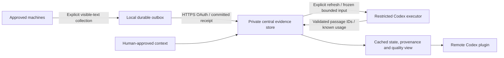

# Hoomy — 0.0.1 research preview

Hoomy explores a chief of staff for coding projects: keep human-approved context,
bring together selected conversations from several machines, and produce a
source-backed project view that is quick to inspect and correct. This research preview
combines working components with a deliberately visible research foundation.
Hoomy 0.0.1 is published as a research preview. See
[publication provenance](PUBLICATION-PROVENANCE.json) for the reviewed source pin
and documentation-only publication changes.

## What works

- A macOS/Linux collector enrols through a phone/browser login. Ordinary login
  enables presence only. Reading and uploading visible conversation text needs
  a separate, explicit project/root policy and grant.
- A self-hosted HTTPS gateway authenticates allowed GitHub identities and issues
  separate user/collector OAuth grants. A private Python backend stores approved
  context, immutable evidence versions, receipts and project-state jobs.
- A remote Codex plugin reads cached project context/evidence and edits approved
  context with revision checks. Explicit refresh creates a bounded inference
  job; a separate Mac executor uses host-owned Codex authentication.
- The state pipeline journals each call, resolves passage IDs to exact stored
  evidence, and exposes a versioned reader-quality projection. Reading a cached
  profile or citation does not invoke a model.

The current design is one private workspace with an operator allowlist, not
isolated accounts in a public multi-tenant service. Collection and synthesis
have independent disabled-by-default project gates. Repository synchronization,
unattended broad collection, training and autonomous Act/Learn execution are
not enabled by this candidate.

## Run and configure

Start with [central deployment](deploy/central/README.md), then the
[collector](agent/README.md) and [project-state executor](deploy/project-state/README.md).
The [backend](backend/README.md) contains source-run instructions and retained
local experiments. The [gateway](services/hoomy-gateway/README.md) documents
identity, scopes and the fixed API surface. Runtime state belongs outside the
checkout, in operator-owned volumes/directories.

Self-hosting requires an HTTPS origin, a GitHub App callback at
`/auth/github/callback`, protected secrets and allowed stable GitHub user IDs.
A default `https://my.hoomy.dev` in the existing collector/plugin is an endpoint,
not permission to upload. Select your server deliberately and configure the
remote plugin endpoint before connecting. Keep the Python API private; expose
only the authenticated gateway. A new installation must configure its canonical
project records and independent project gates before collection or execution.

Node 24 and Python 3.12 are the development baseline. The gateway/plugin supply npm lockfiles; collector downloads have pinned
digests. The optional backend agent requirement is version-pinned, not a full
transitive lockfile. The platform candidate version `0.0.1` is separate from the signed
collector's existing `0.2.5` and the component package/plugin versions. Published
signed archives are immutable; a source snapshot is not a replacement archive
or an automatically trusted installer. See [release preparation](release/README.md).

## Privacy, inference and evidence

No personal knowledge base, conversations, auth database, provider credentials,
private receipts or runtime artifacts belong in this public source snapshot.
The collector omits reasoning, system/developer messages, tool bodies and typed
internal approval-review sessions. Its conservative credential filters cannot
prove that arbitrary user prose is secret-free; review your project/root policy.
The current synthesis method accepts at most two eligible devices, with frozen
bounded message selections and clipped prefixes. A third eligible device stops
before inference; unread material and partial coverage remain explicit. Stored
historical views retain their original method and coverage.

An authorized collection uploads selected visible text to the chosen Hoomy
server. External inference is a distinct user decision: selected cached text and
approved context then reach OpenAI through the existing Codex account.
The current central executor is this Codex/OpenAI integration; alternative
providers are not demonstrated by this pipeline. Collector credentials never authorize model calls.

Exact passage membership proves provenance, not that a conclusion follows from
its source or is still true today. Reader-quality checks reject bounded lexical
failures; they are not universal semantic verification. The central project-state
pipeline does not inspect current repositories or verify facts on the live web.
The separate live-verification code is experimental, not part of this pipeline.
Human review, conflicting evidence and partial/unread coverage remain visible.
Native usage counters are observed telemetry, not independent billing proof or
a hard monetary cap. Ambiguous calls are not automatically dispatched again.

## Research and contribution

The existing public [charter](CHARTER.md) and [EXP-0001 design](experiments/EXP-0001-conversation-brief/README.md) are retained unchanged.
Central multi-machine experiments extend that direction; they do not establish
the separate ten-session feasibility result, which remains `not run`.

The [research direction](docs/research/project-charter.md),
[bounded project-state comparisons](docs/research/project-state-bounded-method.md),
[collection/authentication lessons](docs/research/collection-and-authentication-lessons.md)
and authored experiment cases retain the reasoning and failures behind the
components. Local discovery, verification and Act/Learn code includes exploratory
scaffolding: stored feedback changes prompt context; it does not train ranking
weights or implement an RL loop. Future learning infrastructure must follow a
measured objective, consent and held-out evaluation.

Contribute fictional fixtures and aggregate measurements. Do not submit source
sessions, credentials, personal paths, private repositories or identifying
metadata. [The explicit export manifest](release/public-export.json) is a
review boundary, not permission to publish future datasets or the private Git
history. Publication requires a separate review of the generated snapshot.

## License

Project-authored code is [Apache-2.0](LICENSE); project-authored documentation
and research are [CC BY 4.0](LICENSE-DOCUMENTATION.md). Third-party software keeps
its own license. See [NOTICE](NOTICE). These grants do not cover excluded private
evidence or provider-generated records.
