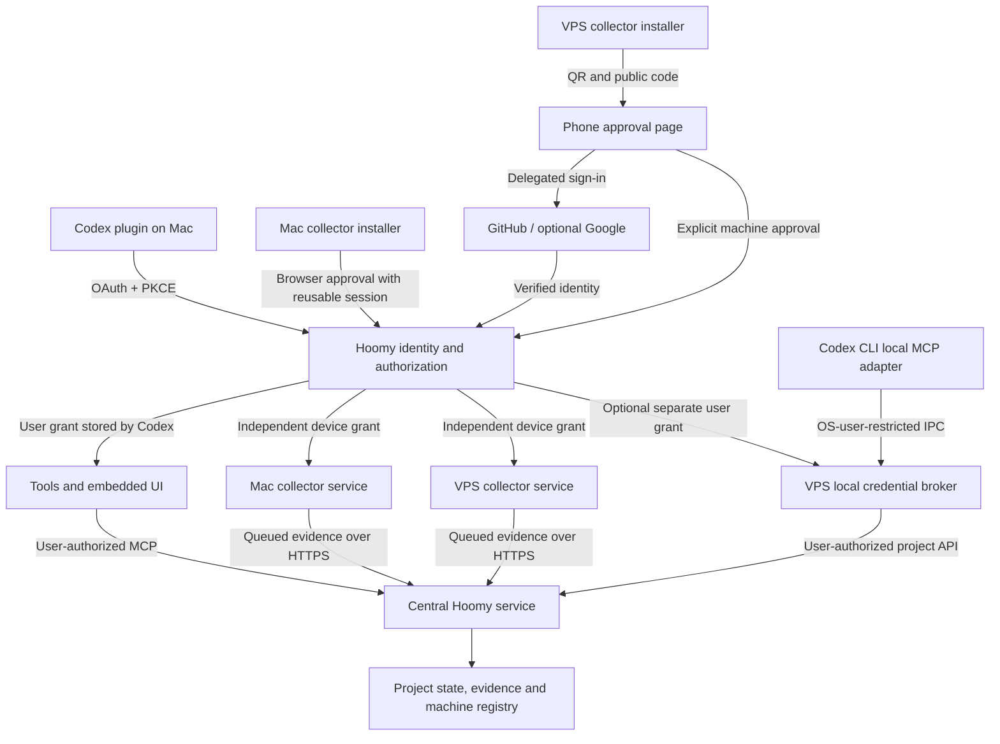

# Hoomy authentication and device enrolment

Authentication and enrolment design, revised 12 October 2026. Companion to
[multi-machine ingestion](multi-machine-ingestion.md). The implemented flow uses
QR/URL phone approval; the VPS requires no local browser. The
[gateway implementation](../../services/hoomy-gateway/README.md) and
[central runbook](../../deploy/central/README.md) describe current operation.
The sections below distinguish the implemented foundation from planned broker,
repository-access and wider collection options. Reusable consent and renewal
failures are recorded in [collection and authentication lessons](../research/collection-and-authentication-lessons.md).


## Decisions and boundaries

Use `https://my.hoomy.dev` as the default server. One Hoomy account owns the user's project access and enrolled machines. Codex manages a user authorization for the remote MCP plugin; each unattended collector owns a separate device authorization. Authentication, machine approval, collection scope and permission to launch inference remain separate decisions.

Support a Mac browser interface and a headless VPS terminal that displays a QR code, a verification URL and a short confirmation code. Scan the QR with a phone and complete identity verification and machine approval there. This deliberately replaces the earlier requirement of no browser anywhere; no local browser, callback listener or inbound connection is required on the VPS. Hoomy does not send authentication emails.

Use delegated browser identity verification behind Hoomy's own authorization service. The selected primary connector is GitHub, with Google OpenID Connect as an optional alternative. Request identity information for login; repository access is a separate GitHub App installation and permission decision described in [GitHub identity and repository access](github-identity-and-repository-access.md). The provider may require its own MFA or recovery steps; Hoomy does not operate an email-code exchange. Account identity uses the verified provider issuer and stable subject/user ID. Linking another provider requires an explicit authenticated operation; matching email addresses cannot silently merge accounts. Initial account creation follows invitation or explicit sign-up policy and cannot create privileged workspace membership automatically.

The practical promise is **one account, reusable sessions, one approval per client or machine**. It is not one universal bearer token, or one identity check across every machine forever. A valid Hoomy session on the phone can be reused to approve another VPS or Mac without repeating provider login. Mac browser isolation, phone/browser differences, expiry and provider MFA can still require verification.

## Delegated identity options

| Option | Evidence and current design decision |
| --- | --- |
| Sign in with ChatGPT | Official [website integration](https://developers.openai.com/siwc/website) supports OpenID Connect and PKCE, but access remains a limited trial for selected commercial partners. Add it when Hoomy obtains its own approved client registration; do not make initial deployment depend on eligibility. The [quickstart](https://developers.openai.com/siwc/quickstart) distinguishes website identity from open-source ChatGPT plan usage. |
| Sign in with Claude | No public general-purpose identity-provider integration for arbitrary Hoomy users was established by the inspected official documentation. [Claude account documentation](https://support.claude.com/en/articles/13189465-log-in-to-your-claude-account) concerns Claude's own login and service access; it does not establish a third-party OIDC login product. Treat availability as unconfirmed, not as proof that such a product can never exist. |
| Google | [Documented OpenID Connect](https://developers.google.com/identity/openid-connect/openid-connect); optional alternative. Hoomy registers its web callback and creates its own account/session after verifying the provider identity. |
| GitHub | Selected primary login. Use a GitHub App's user OAuth authorization and obtain the stable authenticated GitHub user ID through its API; do not treat a GitHub OAuth token as an OIDC ID token. Installing the app on selected repositories is a separate explicit decision. |
| Hoomy passkeys | Possible later identity method using [WebAuthn](https://www.w3.org/TR/webauthn-3/), without Hoomy authentication email delivery. Requires credential registration and a deliberate recovery/backup policy; not necessary for the first delegated-login release. |

Hoomy is the authorization server for its plugin and agents; the external provider verifies the human's identity. Provider tokens are exchanged/validated server-side and are not passed to collectors or the plugin. Hoomy issues its own scoped, revocable grants. Identity login does not grant access to ChatGPT/Claude conversations, subscription inference or other provider data. No existing Codex/Claude token files are imported to authenticate a Hoomy user.

## Installer experience

The existing collector distribution uses the operator-selected HTTPS origin.
The public default installation entry point is:

```sh
curl -fsSL https://my.hoomy.dev/install.sh | bash
```

The published bootstrap installs the signed agent and continues into explicit
server selection and login. Release-source preparation does not execute it or
revalidate the deployed artifact. Wider grouped broker approval below remains
a proposed extension; ordinary collector and native plugin consent are separate.

1. Download the bootstrap from the official distribution origin, detect macOS/Linux and CPU architecture, and install the appropriate verified release. The distribution origin and the user's selected Hoomy server are separate concepts.
2. Prompt for `Hoomy server [https://my.hoomy.dev]:`. Enter accepts the default. Normalize an omitted scheme to HTTPS, validate the server's TLS certificate and discovery response, and display the canonical origin before authentication. Do not silently follow authentication redirects to an unrelated issuer or reuse credentials from a different origin. An explicitly configured issuer can be a separate trusted origin.
3. Open the verification page on a Mac with an interface; also offer QR/URL approval from another device. On Linux without a desktop, show a terminal-rendered QR, URL and confirmation code directly. A Mac can use the same phone approval path.
4. Authenticate, choose a workspace if needed, name the machine, and confirm the proposed Codex history roots, exclusions and content tier. Initially default to metadata collection; uploading transcripts requires an explicit choice. Show what the selected server will receive. Inference approval remains separate.
5. Create the device grant, persist credentials atomically, then enable and start the supervised service. Report the server, account, workspace, machine ID, collection policy, service state and first successful heartbeat. Distinguish connected from uploaded and analyzed.

Because the bootstrap arrives over a pipe, prompts and secret input must read from `/dev/tty`, not the script's standard input. Streamed shell execution is the conventional quick-start shape; a hardened launcher can first download a complete bootstrap and execute it only after successful transfer. Signed release verification protects the downloaded agent relative to the bootstrap's trust anchor, not against a compromised bootstrap origin.

Without a controlling terminal, fail with an actionable message before login rather than hang or silently consent. Proposed options include `--server`, `--auth terminal`, and `--no-start`; a fully automated deployment would need a separate, narrowly scoped, one-use enrolment credential supplied through protected stdin or a secret file, not a reusable account credential in shell arguments. This automated mode is a later extension, not required for an interactive SSH terminal.

Install as the OS user whose histories will be collected. Do not interpret a root shell's home as the intended user's home. Reinstallation preserves the installation ID, policy, outbox and valid grant; it does not create duplicate machines. Copying a machine image to another host requires fresh enrolment and credentials.

macOS uses a LaunchAgent for the signed-in OS user. The default Linux deployment uses a dedicated systemd system service running as the enrolling user, without user lingering. The installer prepares a reviewable unit before its separate administrative installation. Existing user-service deployments remain an explicit compatibility mode. The installer must explain any OS privilege step; successful GitHub login does not authorize administrative operations. Login success without a durable service is not installation success; an SSH-shell background process is insufficient.

## Connecting the Codex plugin on a Mac

1. Install or select the Hoomy plugin and its remote MCP connection. The default resource is `https://my.hoomy.dev/mcp`. A custom server must be selected before the host starts authentication and must remain visible in connection settings.
2. Codex discovers the protected resource and authorization server, then initiates Authorization Code with PKCE. Hoomy's login interface verifies identity or reuses a valid Hoomy browser session. Choose the workspace and approve project reads and user-approved project edits.
3. The authorization server returns the code to the validated Codex callback. Codex exchanges it and stores its connection credentials. Hoomy never asks the embedded plugin page or the language model to handle them.
4. Tools and the embedded interface use this same MCP connection. Reading state and committing approved context edits do not trigger separate logins. The UI calls the existing host tool bridge; the server records the authenticated user and enforces current membership.
5. The plugin can display registered machines and offer the collector installation command. Installing a remote plugin does not by itself install an unattended local daemon or give arbitrary shell hooks access to Codex's OAuth tokens.

[OpenAI's plugin authentication documentation](https://developers.openai.com/plugins/build/auth) describes OAuth discovery and PKCE for remote MCP. [Codex MCP documentation](https://learn.chatgpt.com/docs/extend/mcp?surface=cli) describes stored OAuth connections. These establish the host-managed connection, not a credential-export API for local collectors. Callback and client-registration compatibility must be validated against the target Codex versions before rollout.

### Using Hoomy tools from Codex on a headless VPS

Native remote-MCP QR/device authorization is not established by those documents. To support Hoomy project queries and approved edits from Codex CLI without depending on that feature, retain a local stdio MCP adapter as the planned Linux alternative. It delegates HTTPS authentication to a local Hoomy credential broker and exposes the same tools and central domain behavior. The existing local bridge needs evolution; this alternative is not available unchanged today. Validate native host support first; use this adapter only if needed.

The installer can offer `Connect Hoomy tools to local Codex?` separately from collector approval. If selected, create a pending user-client authorization linked to the machine enrolment before opening the phone approval page. The authenticated phone session can approve both declared requests with distinct permission summaries. Issue a device grant for ingestion and a separate user grant for the broker's project read/edit API; never give the collector user-edit authority. Each public client polls with its own device code and resource. Grouping their approval page is a Hoomy extension, not a guarantee of arbitrary OAuth-server support.

The broker owns and renews the user credential; the stdio adapter obtains authenticated results through local OS-user-restricted IPC. The collector continues to own its separate device grant. Hooks and model-visible tools still see no credentials. This provides a design for headless tools and collection, at the cost of maintaining a local adapter/broker. It does not create a local browser session or guarantee that a desktop embedded interface is available in Codex CLI.

## Enrolling a collector on a Mac with an interface

The installer creates a local installation UUID and a pending enrolment request. It prepares the proposed roots and collection tier without uploading history bodies. The user sees the server and requested machine permissions.

The collector starts an OAuth Device Authorization flow associated with that enrolment. It displays the short confirmation code and opens the returned verification URL. The authenticated Hoomy page shows the code, machine label/platform, target workspace and collection policy. The user checks these and approves. A browser session from the plugin can reuse account authentication, but approval of the machine is still explicit.

The collector polls the token endpoint over HTTPS and receives only its own device access/refresh tokens. No callback to the Mac and no SSH tunnel are required. Codes expire, pending requests can be denied, and approval must remain bound to the initiating collector's secret enrolment ticket/device code. The public confirmation code alone cannot obtain a grant. Device labels and installation UUIDs are claims supplied by the client, not hardware attestation.

Complete verification, consent and the final redirect in the same browser. For
phone approval, begin and finish on the phone. The provider marks the public code
in flight when verification is confirmed, so another browser cannot reuse it
even before expiry. If the original browser cannot finish, initiate a fresh
request for the chosen browser. A registry entry alone does not prove client
activation: confirm token receipt, successful CLI activation and a supervised
heartbeat.

Use the [OAuth Device Authorization Grant](https://www.rfc-editor.org/rfc/rfc8628.html) as specified: honor the polling interval, slow down when requested, and stop on denial or expiry. The same flow works for a local Mac page and a phone approving a headless VPS.

## Enrolling a collector through an SSH terminal and phone

1. After server selection, prepare a labelled enrolment and request device authorization from Hoomy. The response contains a secret device code for polling and a public verification URL/code for the user.
2. Encode `verification_uri_complete` as a QR in the terminal. Also display `verification_uri`, the short `user_code`, expiry and waiting status. QR rendering must work through SSH with an adequate quiet zone and readable terminal sizing; the textual fallback remains available.
3. Scan from the phone. The Hoomy page reuses a valid phone session or offers GitHub, optionally Google, and any enabled identity connector. Provider login redirects back to Hoomy's HTTPS callback, never to the VPS or a phone loopback address.
4. Compare the short code shown on the phone with the terminal, check the device label/platform, select the permitted workspace and approve the collection-policy revision. Merely opening/scanning the URL does not approve anything. Optional local Codex user permissions receive their own explicit confirmation.
5. The original collector polls `/oauth/token` and receives its own device grant after approval. The phone receives confirmation, not collector tokens. Persist credentials, activate the device and start the supervised service. Any optional broker obtains only its separately approved user grant.

For example, use the fictional command `ssh operator@vps.example` with outbound HTTPS only. The VPS needs no existing Codex login, desktop, browser or inbound callback. The phone does need a browser and network access to the selected Hoomy origin and identity provider. A custom/private server must be reachable from both devices.

The QR contains the verification URL and public user code, never the polling device code, enrolment ticket, access token or refresh token. It is a shortcut to an expiring authorization request, not an identity proof or long-lived login credential. Expired or denied requests require a fresh QR. The RFC explicitly supports QR representations and requires the short code to remain displayed even with the complete URL.

## Shared authorization model

| Principal | Proposed permissions | Credential owner |
| --- | --- | --- |
| Plugin user | `projects:read`, `projects:context:write`; device listing/approval/revocation when permitted by workspace role | Codex host; embedded UI receives no secrets |
| Collector device | `evidence:ingest`, `device:self`, `device:jobs`; restricted by workspace membership and approved collection policy | Local collector OS account |
| Browser approval session | Inspect/configure/approve this enrolment and any declared local user-client request; current account membership required | Hoomy browser session, on Mac or phone |
| Worker | Authorized job claims and guarded results | Server/service environment |

Do not give a collector user-context edit or device-administration authority. Hooks only signal the local outbox; they need no remote credentials. The service validates issuer, audience, grant status, device identity, current membership and permissions on every API call. A client-supplied project, workspace or device ID never grants access by itself.

Use distinct logical protected resources for `/mcp` and the collector API, advertised by discovery. Plugin tokens cannot be replayed against ingestion and device tokens cannot be replayed against MCP. A future direct project API client obtains a separate user grant for that API resource. Server adapters share account identity and domain policies, not unrestricted token interchange.

## API contracts

Implemented routes are described in the gateway README. The tables below also
include proposed broker/workspace/repository extensions; their presence does not
claim deployment. Application payloads use JSON; OAuth endpoints use their standard form encoding and errors. HTTPS is required. Secret-bearing responses carry `Cache-Control: no-store` and must be redacted from logs. Requests include a correlation ID. Public pending-request endpoints have quotas and expiry.

### Discovery and plugin OAuth

| Operation | Input and authentication | Successful result |
| --- | --- | --- |
| `GET /.well-known/hoomy` | Public; selected server origin | Canonical server URL, API version, resource URLs, trusted issuer, authentication methods, installer manifest URL, minimum supported agent version |
| MCP protected-resource metadata and issuer authorization-server metadata | Public; standards-defined well-known locations, discovered from the `/mcp` resource | Resource/issuer association, authorization and token endpoints, supported clients/grants/PKCE; registration information if enabled |
| `GET /oauth/authorize` | Host-generated `client_id`, exact `redirect_uri`, `state`, S256 PKCE challenge, resource and requested scopes; interactive Hoomy session | Single-use authorization code through the validated callback, or a denial |
| `POST /oauth/token` — authorization code | Code, PKCE verifier, client and redirect URI, resource | Access token, token type, expiry, granted scopes and refresh token when authorized |
| `POST /mcp` | Codex's user access token for the MCP resource | Existing tools with central project state and revision-checked commands; domain errors preserved |

Do not embed a shared client secret in the plugin or installer. Client registration must follow the host-supported OAuth mechanisms; validate actual Codex support rather than invent a registration contract. Use the local adapter/broker path described above for headless VPS tools unless native host support is established. Collector credentials alone cannot provide user-edit permissions.

### Pending enrolment and device authorization on Mac or VPS

| Operation | Input and authentication | Successful result |
| --- | --- | --- |
| `POST /v1/enrolments` | Public, rate-limited; installation UUID, label, platform/architecture, agent version and proposed collection policy | `201`: `enrolment_id`, secret `enrolment_ticket`, policy revision, expiry; no device grant or project access |
| `POST /oauth/device_authorization` | Collector public client ID, collector resource, scopes, secret enrolment ticket as a Hoomy extension | Standard device code, user code, `verification_uri`, `verification_uri_complete`, expiry and interval; complete URI encodes the public code and is rendered as a QR |
| `POST /v1/enrolments/{id}/approve` — browser | Authenticated Hoomy browser session with CSRF protection; checked user code, workspace, expected policy revision and decision | Approved/denied enrolment; OAuth polling can complete. No device tokens returned to the browser |
| `POST /oauth/token` — device code | Standard device grant type, device code and client ID | Device access/refresh tokens only after approval; standard pending/slow-down/denied/expired errors otherwise |

The enrolment ticket is a short-lived secret used only for this request; never show it as a confirmation code. Bound unauthenticated pending requests and expire them to avoid database growth. An approved policy cannot be silently expanded after approval; changing its revision invalidates outstanding approval.

### Phone approval and delegated identity

| Operation | Input and authentication | Successful result |
| --- | --- | --- |
| `GET /activate` | Public short user code, supplied by the complete URL or typed manually | Expiring verification page; require Hoomy login before private request details and approval; scanning alone grants nothing |
| `GET /auth/github/start` and `/auth/github/callback` | Browser transaction with state and provider-supported PKCE; server-side code exchange and authenticated GitHub user lookup | Hoomy session bound to verified GitHub identity; resume the original Hoomy request without arbitrary return redirects |
| `GET /auth/google/start` and `/auth/google/callback` | Optional OIDC connector; state, nonce and PKCE, validated issuer/audience/signature | Hoomy session bound to verified Google subject; explicitly link an existing account when appropriate |
| `GET /v1/enrolments/{id}/options` | Authorized browser session and matching pending device request | Verified account summary, permitted workspace choices, proposed policy/revision; no project bodies |
| `PATCH /v1/enrolments/{id}` | Authorized browser session with CSRF protection; proposed workspace/policy and expected revision | Updated proposal/revision before approval; reject forbidden scope or stale revision |
| `POST /v1/client-authorizations` | Registered local broker client ID, user API resource/scopes and originating secret enrolment ticket | Pending optional user-client request linked to the enrolment; no user grant |
| `POST /oauth/device_authorization` — optional broker | Its own registered client/resource/scopes and secret pending user-client request ticket | Separate device code for this user-client request; Hoomy's grouped approval page is shown through the original QR |
| `POST /v1/client-authorizations/{id}/approve` | Browser session, CSRF protection, explicit user permissions and permitted workspace; request must already belong to the declared group | Approve/deny only that user-client request; its own device-code polling can complete |
| `POST /oauth/token` — optional broker | Standard device-code grant, broker device code, client ID and user API resource | Separate user access/refresh grant for the broker, with no ingestion authority |

Keep provider sign-in transactions separate from the device authorization request and preserve their association server-side. Validate provider identity and session before approving. Changing linked requests or permissions after display requires reconfirmation. A denied optional broker request does not prevent an approved collector from being installed. Approval is one durable transition per request and must not mint duplicate independent grants. Lost/ambiguous token completion must be recoverable without leaking a token into the phone page.

The former email challenge routes and custom CLI completion grants are removed from the target design. Hoomy's device grant and browser authorization-code flows cover the target journeys. The selected authorization implementation must support the required resource separation and optional grouping extension; grouping does not turn device credentials into user credentials.

### Device lifecycle and project access

| Operation | Authorized caller / required fields | Successful result |
| --- | --- | --- |
| `GET /v1/devices/self` | Device grant; identity derived from the grant | Device/account/workspace IDs, authorization status, approved policy and revision; no other machine's private configuration |
| `POST /v1/devices/self/activate` | Device grant; approved policy revision and capabilities | Active device when approval is current; repeat activation is idempotent |
| `POST /v1/devices/self/heartbeat` | Device grant; agent version, inventory revision, outbox count, service/capability state | Server time, authorization/policy revision and device work availability |
| `GET /v1/devices` | Authorized user grant | Visible machines, labels, capabilities, last seen, authorization and collection states; no credential values |
| `POST /v1/devices/{id}/revoke` | Authorized user grant and explicit device selection | Device disabled centrally and its grant family revoked; idempotent |
| `POST /oauth/token` — refresh | Refresh token, originating client/resource | New short-lived access token and rotated refresh token; scopes cannot expand |
| `POST /oauth/revoke` | OAuth revocation request for the caller's token | Idempotent revocation; revoking a device refresh grant also disables dependent access via the device registry |
| `POST /v1/events` | Device grant, idempotency key; event ID/schema, sequence, observed time, policy revision and source manifest/hash | `202` only after durable acceptance; receipt ID and processing state. Same event/key returns its prior receipt; different content with reused key returns `409` |
| `GET /v1/receipts/{id}` | Owning device or authorized user | Accepted, processing, applied or failed status, plus affected revisions when available |
| `GET /v1/devices/self/jobs` | Device grant, device capabilities, bounded request | Only this device's permitted jobs and leases; results use separately specified guarded completion contracts |
| `GET /v1/projects/{id}` | User grant for the direct query API resource; current project membership | Central context, revision and source/processing freshness |
| `PATCH /v1/projects/{id}/context` | Authorized user grant; expected revision and approved context fields | Committed profile/new revision; `409` on stale revision. MCP `hoomy_update_project` invokes the same command internally |

No collector token is accepted for project-context edits. Collection policy covers local history roots, exclusions and content tiers; central project permissions also apply when linking evidence. A path supplied by a collector is provenance, not a request for the server to read that path. Source-to-project mapping retains central project UUIDs and per-device locations.

## Credential storage, renewal and disconnection

Use Mac Keychain where background access works for the selected service lifecycle. On a Linux VPS, use a supported OS credential store or a protected, owner-only credential file accessible to the collector's service account; do not call a file hardware-protected storage. Never store tokens in the repository, hook configuration, outbox payloads or model-visible logs. Refresh tokens are durable; pending-request credentials are transient. Keep independent profiles for each server origin and account/workspace. Switching a server requires explicit selection and its own login; it never redirects queued evidence to the new destination.

Proposed initial limits are ten minutes for pending device enrolment/QR validity and fifteen minutes for access tokens. Device refresh grants can have a ninety-day inactivity expiry while allowing active unattended service to renew. Final limits depend on the authorization implementation and account policy. Outstanding pending enrolments do not renew indefinitely; browser sessions have their own account-policy lifetime.

Rotate refresh tokens and detect reuse as described by the [OAuth security best current practice](https://www.rfc-editor.org/rfc/rfc9700.html). Exactly one local component owns refresh; serialize refresh requests and persist replacements atomically. Avoid a collector and interactive CLI independently refreshing the same grant. Failed/ambiguous refresh can require login again; never keep replaying an old refresh token. Device revocation takes effect at the API registry check, rather than waiting only for a self-contained access token to expire.

Disconnecting the plugin revokes its user connection, not every collector. Revoking Mac B leaves Mac A and the VPS connected. Local collector logout stops remote work, requests grant revocation and removes local credentials; if the network is unavailable, report central revocation as unconfirmed and offer account-level revocation elsewhere when possible. Preserve local evidence/outbox until the user chooses what to do with it. Pausing collection is distinct from logout and from deleting centrally stored evidence.

## Errors and recovery visible to the user

| Condition | API behavior | Client experience |
| --- | --- | --- |
| Failed provider login or required factor | No approved Hoomy request or machine grant | Complete provider authentication or cancel; never activate an unauthorized service |
| Denied/expired enrolment | Pending request cannot complete | Agent stays installed but disconnected; proposed `hoomy login` resumes without reinstalling |
| Expired access token | `401`; refresh once when grant is valid | Background renewal, no per-conversation login |
| Revoked grant / lost membership | Refuse requests; token refresh fails or device registry returns an explicit reason | `needs_login` or `revoked`; stop remote upload, preserve bounded local outbox |
| Insufficient permission | `403` with stable domain error | Explain missing permission; do not repeatedly prompt for login |
| Stale policy/profile revision | `409` with current revision | Reload and reconfirm the changed proposal/edit |
| Rate limit | `429`, retry delay | Bounded retry; challenge resend throttling separate from outbox retry |
| Server/network unavailable | No successful receipt | Preserve outbox and retry with backoff; connected/received/analyzed remain separate states |
| Unsupported version/platform or service setup failure | Fail the relevant installation phase | Preserve usable installation/configuration; report the unfinished phase accurately |

Application errors contain a stable code, readable message, retryability and correlation ID. OAuth errors keep standard OAuth semantics, including normal pending responses for the device flow. Error responses and diagnostics never include access tokens, refresh tokens, device codes or enrolment tickets; successful secret-bearing responses are limited to their intended authentication client.

## Authentication topology



## Acceptance criteria before implementation is considered ready

- A new Mac can run one command, accept the server default, authenticate, approve collection and report an active collector. Existing plugin browser authentication can be reused where the browser session allows it.
- A new VPS can complete installation through an SSH terminal displaying a QR/URL/code, with approval on a phone and no local browser or prior Codex connection. Hoomy sends no authentication emails.
- When local Codex tools are selected on the VPS, the same phone session can approve the declared local broker user grant separately from ingestion. The stdio adapter can query/edit central projects without native host QR authentication.
- On the Mac, plugin tools and embedded project edits reuse the host-managed user connection. On the VPS, local tools reuse the broker-managed user connection. The embedded UI and local hooks never handle remote credentials.
- All three collectors remain active after Codex exits; the Linux service survives SSH logout and reboot according to its selected service setup.
- Revoking one machine prevents its next protected API operation while leaving the other devices and plugin grants intact.
- Cancelling login or losing a token response leaves no collecting service with invented authorization; rerunning installation/login does not duplicate a working device.
- Offline collection retains permitted evidence within configured limits. A durable receipt, applied analysis and project knowledge freshness are reported separately.
- Server/account changes, machine cloning, policy expansion, expired sessions and required MFA cannot silently reuse or widen an existing grant.
