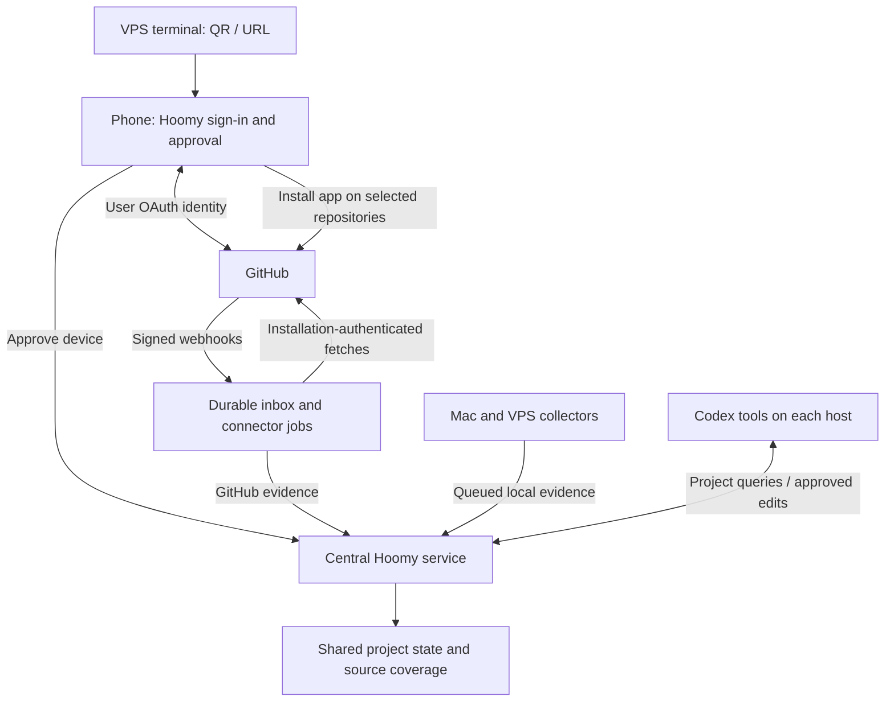

# GitHub identity and repository access

Design proposal, 10 October 2026. GitHub is the selected primary login provider; Google is an optional alternative. The [authentication design](authentication-and-device-enrolment.md) uses QR/URL device approval on a phone for headless machines. This document adds direct repository access alongside distributed Codex collection. The Hoomy Dev GitHub App is registered, and user identity login is implemented; current consent and operation boundaries
are documented in the [central runbook](../../deploy/central/README.md). Repository installation and synchronization remain future work.

## One GitHub integration, two explicit decisions

Use a GitHub App for Hoomy. Its [user OAuth flow](https://docs.github.com/en/apps/creating-github-apps/authenticating-with-a-github-app/authenticating-with-a-github-app-on-behalf-of-a-user) identifies the person signing into Hoomy; its installation on selected repositories authorizes a separate server-to-server connector. Signing in alone does not connect repositories. A returning user can reuse GitHub/Hoomy sessions, but repository selection and permission approval remain explicit.

GitHub [recommends GitHub Apps for integrations](https://docs.github.com/en/apps/creating-github-apps/about-creating-github-apps/deciding-when-to-build-a-github-app). They support selected-repository installations, fine-grained permissions and webhooks. These properties fit Hoomy's central connector better than asking for a broad OAuth `repo` scope.

The Hoomy account ID remains independent of a GitHub username. Link the verified stable GitHub user ID to that account; store a username as a changeable label. Google identities can be explicitly linked to the same account after verification. Neither email matching nor a repository owner name establishes identity or Hoomy workspace membership.

## User journey

1. On Mac, connect the plugin or run the agent installer. On a VPS, run the installer, select the server and scan its QR from a phone.
2. Select `Continue with GitHub`. Hoomy validates the GitHub OAuth transaction, retrieves the authenticated identity and creates/reuses its own session.
3. Approve the selected machine's collection policy. This can complete without a repository connection.
4. Offer `Connect GitHub repositories`. Explain the information Hoomy will collect and open GitHub's Hoomy App installation page in the same browser/phone session.
5. Select the personal or organization account and the repositories to connect. Organization policy may require an owner/admin approval; show that pending state without blocking machine enrolment.
6. On return, verify the installation through GitHub APIs and associate it with an authorized Hoomy workspace. Never trust an `installation_id` callback parameter as proof of ownership or authority.
7. Select enabled repositories and confirm their mapping to existing Hoomy projects. Show suggested links to local checkouts, and request confirmation when ambiguous.
8. Display initial synchronization progress and last successful synchronization independently from machine collection and knowledge processing.

Hoomy may use one GitHub App registration for login and repository integration. User authorization, app installation, repository selection and Hoomy workspace binding are distinct records. A Google-authenticated user can connect GitHub too, after verifying the relevant GitHub identity/installation authority. Browser callbacks and temporary state live on Hoomy's server, not on the VPS terminal.

## Proposed collection permissions

| GitHub permission | Proposed use |
| --- | --- |
| Repository metadata: read | Identify repositories and their stable IDs, branches and access state |
| Contents: read | Approved source/documentation content and commit history from selected repositories |
| Pull requests: read | PR descriptions, changes, reviews and merged/open state |
| Issues: read, if enabled | Issue discussions and status as additional project evidence |
| Checks/actions/deployments: read, later if needed | CI or deployment evidence only when the corresponding feature is introduced and approved |

Initial access is read-only. Request permissions for the selected evidence features; optional permissions may require a separate app configuration or an explicit permission expansion and GitHub approval rather than arbitrary runtime switches. The data collected by Hoomy can be narrower than the app's GitHub-granted ceiling. Do not turn a selected-repository installation into permission to index every file/version automatically: configure branches, paths, content limits, exclusions and inference consent.

Writing comments, opening PRs or changing files would be separately designed capabilities with explicit permissions and action authorization. Reading a PR or issue does not authorize posting a reply.

## Three complementary evidence channels

| Channel | What it contributes | Coverage limit |
| --- | --- | --- |
| Central GitHub connector | Pushed commits/content, pull requests and enabled collaboration/CI records | Only installed repositories and permitted GitHub data; no unpushed local work or Codex conversations |
| Collector on each Mac/VPS | Approved Codex histories, local project locations and collected evidence | Availability and the approved local policy bound what can be captured and uploaded |
| Codex-mediated local investigation | User-authorized inspection of working trees and local resources | Interactive execution depends on the host, permissions and available checkout |

All channels link to central project UUIDs with separate provenance. A GitHub repository's stable ID helps connect checkouts across hosts, but one repository may contain several Hoomy projects and a project may span several repositories. Model repository/project bindings as many-to-many and preserve path/branch filters. Forks, remotes and monorepos need explicit interpretation.

GitHub evidence records provider/repository IDs, ref and commit SHA when applicable, path or issue/PR identifier, observation time and source URL. Local evidence also records device/location and working-tree state. Preserve disagreements rather than replacing unpushed local state with the remote default branch. A merged PR or green check is evidence; it does not automatically mark the user's whole project complete.

## Central asynchronous connector

The VPS stores the GitHub App signing key and webhook secret in server-owned secret storage. Generate short-lived installation tokens on the backend, restricted to the linked installation/repository set and required permissions. [GitHub installation authentication](https://docs.github.com/en/apps/creating-github-apps/authenticating-with-a-github-app/authenticating-as-a-github-app-installation) permits independent server-to-server access. These credentials never go to local collectors, Codex hooks or model-visible tool results.

Receive relevant webhooks for installed permissions/features. Validate the [HMAC signature over the original payload](https://docs.github.com/en/webhooks/using-webhooks/validating-webhook-deliveries), match the installation to its authorized workspace, deduplicate by delivery ID and durably record the event before returning a prompt successful response. Then enqueue reconciliation/fetch jobs; never hold webhook requests open for indexing or model inference. Apply the existing durable inbox/worker boundary.

Use webhooks as change notifications plus periodic reconciliation and an initial bounded backfill. Do not assume webhook payloads contain every file or complete historical evidence, or that every missing delivery is automatically retried. Track delivery/job failures, provider rate limits and recovery. Installation removal, suspension, permission changes and repository-selection changes update access/coverage state promptly.

Stop new fetches when access is removed. Removing the connector does not silently erase stored evidence: central retention/deletion policy controls that separately, while project access remains governed by current Hoomy permissions. An organization installation can outlive its original installer; workspace administration and member access must therefore be managed explicitly.

## Proposed Hoomy API contracts

GitHub's provider endpoints remain separate from these Hoomy application routes. Browser mutations require session authentication and CSRF protection; direct client mutations require a user API grant and workspace authorization. Provider secrets are never returned.

| Contract | Input/authentication | Result |
| --- | --- | --- |
| `GET /auth/github/start` and `/callback` | State-bound browser OAuth transaction and verified provider response | Hoomy session with linked stable GitHub identity; no automatic repository binding |
| `POST /v1/integrations/github/install-intents` | Authorized Hoomy user, workspace and requested collection features | Expiring intent ID and GitHub installation URL bound to a browser transaction |
| `GET /integrations/github/setup` | GitHub browser return associated with a pending intent; installation ID is untrusted until verified | Pending/verified connection; check the signed-in person's installation access and authority through GitHub |
| `GET /v1/integrations/github/installations` | User and workspace membership | Visible verified installations, approved permissions, connected/pending/suspended state |
| `GET /v1/integrations/github/installations/{id}/repositories` | Authorized user and verified installation | Repositories actually accessible to Hoomy's installation; paginated and checked centrally |
| `PUT /v1/projects/{id}/repository-bindings/{binding_id}` | Authorized user; provider repo ID, installation reference, path/ref filters, collection policy and expected revision | Revision-checked project/repository binding; provider access validated, ambiguous linking requires confirmation |
| `POST /v1/integrations/github/sync` | Authorized user, permitted installation/repository set and idempotency key | `202` with bounded synchronization job ID; no immediate inference result |
| `GET /v1/integrations/github/status` | Authorized user and workspace | Initial-sync progress, last successful reconciliation, queued/failed jobs and evidence/knowledge freshness |
| `POST /webhooks/github` | Provider HMAC signature, delivery ID, event type and original body | Successful acknowledgement after durable acceptance; repeated deliveries do not repeat application |
| `POST /v1/integrations/github/installations/{id}/disconnect` | Authorized workspace administrator and selected connection | Disable the Hoomy connector; GitHub app uninstallation is a separate explicit operation |

Do not accept repository access through a device ingestion token. User project queries and changes keep the shared Hoomy authorization and revision rules. Responses distinguish unavailable provider access from unknown/missing evidence and completed analysis.

## Combined topology

## Rollout sequence

1. Register the GitHub App, establish user login and optional Google linking, and validate the Hoomy OAuth/QR machine flow.
2. Add selected-repository installations, explicit project bindings and bounded read-only backfill.
3. Add signed webhook ingestion, reconciliation and visible coverage/progress alongside local collectors.
4. Validate revocation, organization approval, private-repository visibility, device-offline behavior and conflicting local/remote evidence before broadening data permissions.
