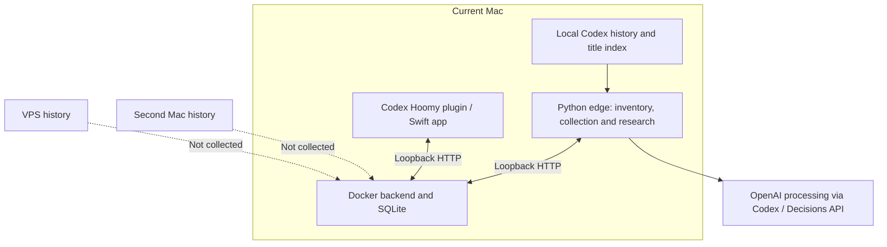
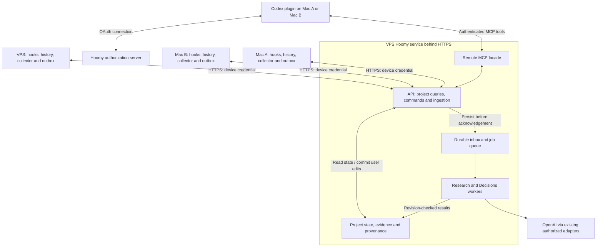

# Hoomy collection across multiple machines

The central HTTPS service owns project context, immutable conversation
projections and cited state. Its remote MCP facade exposes authenticated project
reads and approved edits. Separate Mac and Linux VPS collectors send explicitly
approved visible-message projections through a durable private outbox. The
current collector reconciles periodically; hooks are an optional future adapter.
Collection never schedules inference. Wider resource-dependent execution remains
an architectural option, separate from the bounded project-state executor.

See the [central runbook](../../deploy/central/README.md),
[scoped ingestion contract](conversation-ingestion-contract.md) and
[project-state contract](project-state-api.md) for implemented boundaries.
Auth/device and parser failure lessons are retained in
[research](../research/collection-and-authentication-lessons.md).

## Current implementation and deployment

The initial read-only inspection confirmed the local backend at `127.0.0.1:8765`, the Docker container `hoomy-private-pilot-backend-1`, and a host process running `python -m hoomy.edge`. Discovery was paused; scope and inference consent were already confirmed. These deployment observations are a dated baseline, not a continuous health check.

The database contained 719 catalogue records, 514 stored snapshots and 15 unmerged projects. Raw snapshot bytes totalled 483,972,817 bytes (about 462 MiB); the SQLite main database occupied 676,274,176 bytes (about 645 MiB). These are different coverage measures: a catalogue entry does not imply a complete stored conversation or completed analysis. The database size excludes WAL files and backups.

| Component | Existing behavior | Implication for multiple machines |
| --- | --- | --- |
| `backend/hoomy/catalog.py` | Inventories `sessions` and `archived_sessions`; obtains titles from `session_index.jsonl` and optionally read-only `state_*.sqlite` | Reuse the local reader on every host. Metadata discovery does not require uploading all bodies. |
| `backend/hoomy/collector.py` | Reads stable JSONL snapshots, computes SHA-256, preserves raw bytes and source line references; full snapshots are limited to 16 MiB | Keep integrity and evidence checks; add machine provenance and acknowledged delivery. |
| `backend/hoomy/edge.py` | Combines collection, recognition, deepening, research and startup of Decisions threads | Split roles before running it on three hosts. Its lock prevents duplicate processes only within one local state directory. |
| `backend/hoomy/store.py` and `overview.py` | Catalogue and sessions keyed by session ID; snapshots keyed by content hash; one global worker/discovery state and overview pass | Add source locations, inventory state and consent per device. A single worker status currently gets overwritten by whichever host reports last. |
| `backend/hoomy/act_inference.py` and discovery readers | Open `source_path` under the worker's own Codex history root | A central catalogue alone cannot make another machine's files readable. Introduce an evidence resolver. |
| `backend/hoomy/act.py` and `ideas.py` | Some tasks already have atomic claim transitions and expiry | Reuse these primitives, but add explicit worker ownership, leases and source-aware routing across all job types. |
| Docker backend | Stores SQLite in a dedicated volume; does not mount Codex history or credentials | It can move to Linux independently of the Mac interface and Codex inference process. |
| Swift app and MCP bridge | Both use loopback HTTP; the bridge rejects remote hosts | Introduce authenticated HTTPS clients. Prefer a remote MCP server for the Codex plugin; a retained Swift client needs its own OAuth client registration. |
| `backend/run.py` | Starts Docker locally, builds/signs/opens the Swift app and starts the combined edge | Introduce separate backend, collector, worker and client launch commands. The current launcher is not a Linux installer. |

Recognition normally starts with titles and directory metadata. Approved deepening and some subsequent discovery passes ingest selected raw snapshots. Activity research also has a separate bounded excerpt reader with a 512 MiB scan budget; those excerpts do not imply that a full raw snapshot was stored. Preserve the distinction between metadata, excerpts and complete snapshots during migration.

The API has no application authentication. The Docker port binds to loopback, and `server.py` also checks the HTTP Host/Origin boundary. Setting a remote URL or publishing port 8765 is insufficient and would remove the current security boundary.

The latest inspected commits are `bda4027` (editable project context) and `18c938c` (brand alignment); plugin version is 0.2.1. `hoomy_project` reads the profile, and `hoomy_update_project` saves approved user context through a revision-checked patch. The embedded UI already calls MCP tools through its host bridge rather than placing backend credentials in the page. Preserve that boundary when moving MCP remotely.

`project_dialogue.py` already stores dated context records, supersession and clearing markers, rejects stale profile revisions, and invalidates selections based on old goals. These behaviors are the starting point for central commands. The marketplace's `authentication: ON_INSTALL` policy does not implement an authorization server or authenticate the current loopback backend.

## Operator preflight findings

A shared Linux host needs an explicitly reviewed reverse-proxy network and
virtual host; existing applications may already own ports 80/443. Keep the
private backend loopback-only, and measure available memory, disk and swap
rather than assuming the capacity of an earlier development host.

Noninteractive SSH PATH can differ from the signed-in terminal. Collector and
worker service definitions need explicit executable paths. Verify the installed
Codex executable, approved history roots and interpreter compatibility; a version
check does not establish usable sign-in or inference authorization. Retaining the
backend image interpreter avoids combining relocation with an interpreter change.

An unattended collector needs a reviewed system service running as the enrolling
OS user, or an explicitly selected user-service compatibility mode. A running
user service manager does not establish lingering, survival after SSH logout or
boot persistence. Confirm the actual service and authenticated heartbeat.

History growth, backup copies, WAL files and old/new Docker images share disk
capacity. Measure current free space and set storage limits, retention and a
protected off-host backup destination before a separately authorized migration.

## Proposed topology

Collectors initiate connections and fetch authorized source-read or verification jobs. The backend needs no inbound access to either Mac. The public boundary exposes purpose-specific endpoints, not unrestricted access to the current pilot's control, reset or worker APIs. Existing source files remain on their original host; central storage receives only approved data.

## Authentication and client boundaries

Use one Hoomy account and authorization service, with distinct user and device permissions. The intended experience is to connect Hoomy in Codex and approve each machine once; conversations then reuse the installed authorization. A new machine or revoked authorization can require renewed approval.

Official OpenAI documentation supports [OAuth 2.1 for authenticated plugin MCP servers](https://developers.openai.com/plugins/build/auth), including discovery and PKCE. [Codex HTTP MCP connections](https://learn.chatgpt.com/docs/extend/mcp?surface=cli) can use stored OAuth credentials. Neither page establishes an API for arbitrary local scripts to extract a plugin's tokens. Do not make token-file scraping or reuse of Codex's own OpenAI login part of the design.

| Caller | Intended credential and permissions |
| --- | --- |
| Codex tools and embedded plugin UI | Host-managed OAuth connection to remote Hoomy MCP; project reads, approved edits, and explicitly requested research. The UI invokes tools and receives no access/refresh token. |
| Local collector and hook infrastructure | Independently revocable device grant linked to the same account; upload within approved scope, acknowledge deliveries, read that device's jobs and report its heartbeat. No authority to edit user intent or reset central data. |
| Research and Decisions workers | Separate service identity for claiming permitted jobs and submitting guarded results. Model-provider credentials remain separate from Hoomy credentials. |
| Future Swift, web or other client | Its own OAuth client against the same Hoomy account and permission model. No dependency on extracting a Codex connection's secrets. |

Device enrolment is a proposed Hoomy workflow, not a claimed Codex SDK feature. The local collector initiates an expiring request tied to its installation and a secret enrolment ticket. Both Mac and VPS use OAuth Device Authorization: a Mac can open the approval page locally; a VPS displays a QR/URL/code for approval in the phone's browser. The latest design replaces the earlier email-code proposal and requires no Hoomy authentication emails or local VPS browser. The collector completes enrolment over its own secure channel and stores its own device credential in an OS credential store or protected service-account file. Tokens never travel through a model-visible tool result or the embedded UI. Public confirmation codes do not themselves authorize ingestion; bind approval to the originating request, expire it and allow only one completion.

This offers one account with reusable sessions and separate revocable authorizations. A phone's valid browser session can approve new device requests without repeating provider login. Native sharing of one MCP connection can cover tools and supported MCP hooks; unattended collection still needs a credential that works after Codex exits. Native remote-MCP QR authentication on Linux is not established by the collector's flow. If needed for headless Codex CLI tools, the companion design retains a local stdio adapter and credential broker with its own user grant. The same phone session can approve the declared user-client and machine requests separately; the collector never receives user-edit authority.

Bind the authenticated identity to account/workspace membership, allowed projects and device ID on the server. Scope names alone do not establish access to a particular project. Reject payloads that impersonate another device. Validate issuer, audience/resource, expiry and permissions, and implement rotation/revocation. Treat OAuth permission, hook trust, collection consent and authorization to launch inference as separate controls.

## API and asynchronous processing

Direct GitHub collection is a third source channel beside distributed Codex histories and user-authorized local investigation. A GitHub App installed on selected repositories lets the VPS fetch approved remote evidence and receive signed webhooks while Macs are offline. User sign-in alone does not authorize repository collection. GitHub evidence cannot expose unpushed work or local conversations. Link stable repository IDs and device-local checkouts to central projects with explicit bindings; preserve source provenance and conflicting states. Connector notifications enter the same durable inbox/job architecture described below.

Use one application service with two external adapters: `/mcp` for Codex tools/UI, and versioned HTTPS endpoints for collectors and future clients. Both adapters execute the same query/command policies and share the same authoritative state. The default origin is `https://my.hoomy.dev`; route names remain proposed contracts.

| Operation | Contract |
| --- | --- |
| Read a project | Return the current central profile, revision and evidence coverage. Reads are short and bounded. |
| Save user context | Authenticate the user, validate the expected revision, commit the edit, record actor/origin, and return the new revision. A conflicting edit returns a conflict; do not silently queue a draft as saved. |
| Publish evidence or metadata | Persist an authenticated, idempotent submission durably before returning an acceptance receipt, typically `202`. Acceptance means received, not understood or applied. |
| Request research | Authorize and enqueue a job; return its ID. Read progress separately rather than hold a request open for model execution. |
| Fetch device work | Return only jobs scoped to the enrolled device and its capabilities, with bounded leases and result validation. |
| Read progress | Expose receipt/job state and project revision. Preserve the UI's bounded polling initially; push notifications can be added once host delivery and reconnection behavior are validated. |

HTTP remains a suitable authenticated delivery transport. Asynchrony comes from a short acknowledgement and durable processing queues, not from making a hook wait for a model over a different network protocol. An HTTP request from the background uploader does not block the Codex conversation.

Use a durable local outbox and a durable server inbox/job queue. Delivery is at least once; idempotency prevents repeated application. The server commits receipt, blob/manifest references and queued work atomically, or uses a recoverable staging protocol for larger blobs. It acknowledges only when both accepted data and its processing intent are durable. Apply size limits, bounded retries, exponential backoff and jitter, per-device sequences, failed-job inspection and replay. Preserve integrity references and the current explicit oversized-source behavior.

An event envelope carries schema version, event ID, authenticated device/source identity, local sequence, observation time, consent revision and content hash or manifest. Events describe observations such as `source.updated`; explicit user commands describe edits such as updating a goal. Historical text claiming completion remains evidence and cannot silently become a user-approved completion command.

Persist accepted evidence first, normalize it, link it to sources/projects, and schedule authorized inference separately. Project state distinguishes newly received data from knowledge already refreshed from that data. Expose receipt state, processing failures, source freshness and missing coverage. A user reading on Mac A sees committed context from Mac C; evidence still waiting on C is visibly pending.

Retain the existing profile revision checks. The transaction saving a user edit also invalidates or schedules invalidation of dependent work. Workers publish against context/evidence revisions and leases so a result based on old goals cannot overwrite a newer edit. Use an application event log and derived current views without requiring full event sourcing.

For this pilot, start with database-backed inbox, outbox and job tables under one backend owner. Keep SQLite on the VPS initially. An external broker can be added when measured throughput or availability requires it; clients should not connect directly to a public broker. Internal workers continue using the service boundary rather than writing SQLite files concurrently themselves.

## Hook lifecycle and reliable collection

[Codex hooks](https://learn.chatgpt.com/docs/hooks) include `Stop` and `SessionEnd`. `SessionEnd` can occur after closure or inactivity; it is synchronous, has a short timeout, and does not support MCP tool handlers. Background hooks can be cancelled when the session ends. MCP handlers use an existing connection synchronously. The transcript format is not stable. Plugin hooks need trust review. These documented constraints must be checked on the installed clients before implementation.

The proposed hook writes a small local dirty-source record, without credentials, model calls or remote upload, and returns. A supervised collector reads stable source data, enforces scope, captures permitted evidence and drains its persistent outbox independently of Codex. Use turn completion for prompt updates, session end as an additional signal and periodic reconciliation for crashes, missed hooks and existing history. Do not equate a stopped turn with an irrevocably finished conversation.

A local dirty record guarantees an intent to reread, not preservation of bytes that might be deleted before the collector captures them. State that limit explicitly; use persisted snapshot/manifest capture when preservation of a particular version is required. Avoid capturing the collector's own research sessions indefinitely, and preserve parent/source relationships for subagents if those histories are included.

A remote MCP hook can optionally send a small observation using the plugin's existing connection. It cannot read an arbitrary Mac transcript from a path string on the VPS and cannot guarantee delivery while disconnected. It complements the local outbox rather than replacing it. A headless Linux machine can run the collector and reconciliation without a desktop plugin.

### Data and identity

| Proposed entity | Responsibility |
| --- | --- |
| Account and membership | Authenticated owner/workspace, authorized projects and role. Derive access from server-side membership, not payload IDs. |
| Device | Stable installation UUID, owner/workspace, label, revocable credential, capabilities, last heartbeat and inventory revision. A hostname is a label, not identity. |
| Source location | Unique `(device_id, connector, local_session_id)` plus local path, working directory, observed revision and availability. The same conversation can have several locations. |
| Logical conversation | Groups locations only when native identity and compatible evidence support the match. Preserve unrelated ID collisions and divergent copies. |
| Evidence blob | Raw bytes identified by SHA-256; store once for identical bytes. Store parser version separately for normalized messages and preserve hash/line references. |
| Source version | Links a source location to a blob or bounded excerpt manifest, with coverage, local sequence and observation time. Keep simultaneous divergent versions; arrival order or file mtime must not choose a global winner. |
| Project location | Maps a canonical project UUID to `(device_id, local_path)`, optionally supported by a normalized repository origin. User confirmation controls ambiguous matching. |
| Job | Type, required capability, source/project location, worker owner, lease token, expiry, generation, attempt and result revision. |

For example, fictional project `Project Alpha` can map to `/Users/alex/work/alpha` on Mac A, `/Users/alex/Projects/alpha` on Mac B and `/srv/alpha` on Linux. It is one project with three locations. Directory names or matching repository names alone do not prove identity, and different checkouts can represent different branches or states.

The current snapshot table stores one `source_path` per content hash and one current snapshot per session. Add a separate occurrence/version relation so a duplicate hash from Mac B records another location rather than losing provenance, and a delayed upload cannot revert Mac A's newer stream. Keep project IDs and user corrections stable.

### Collection and evidence flow

1. Enrol a device and confirm its own history roots, exclusions and permitted content tier. Distinguish central storage consent from provider inference consent. Existing local consent is not automatically consent to transfer data to a VPS or collect a second host.
2. Publish a metadata inventory per device. Each inventory has its own scan ID, revision and completion state. A disappearing or offline device is not an empty completed inventory and must not erase another device's catalogue.
3. When permitted research needs a body, queue a source-read job for a host holding that source. The local collector rechecks scope and identity, reads a stable version and publishes approved evidence. The initial implementation can reuse full snapshots for files within the current 16 MiB limit; oversized files require the existing excerpt path or an explicit coverage failure.
4. Persist a local outbox/checkpoint outside Git, with bounded storage, backoff and durable acceptance receipts. Retry with an idempotency key bound to the authenticated account/device. A restart or network failure must not duplicate applied evidence or discard pending uploads. Metadata can be rescanned; an immutable captured version is needed if it must survive later source changes.
5. Let the research worker read cached central evidence through an abstraction such as `EvidenceRepository`. Replace direct source-file reads in activity research, deepening and agent discovery. Raw local paths are provenance, not paths to open on the worker host.
6. If a device is offline, use cached evidence with explicit freshness/coverage. Keep uncached source reads waiting for that device; never present them as complete research or proof that a project has no work.

Repository verification is a separate capability. A worker can analyze centralized conversation evidence without having the repository. Checks that require the actual working tree must run on an authorized project location, with their results labelled by device, branch/commit when available, and time. Do not infer completion on Mac B from a successful check on a different checkout on the VPS.

### Processing and access

Start with one research worker on Mac A and a separate Decisions service. Collectors should not call models or start Decisions threads merely because they are installed. Preserve existing discovery pause, content consent, cancellation and inference budgets. Backend-generation checks reject stale results; device scope revisions and job lease tokens must do the same.

After central evidence reads are implemented and tested, the worker can move to the VPS. It should consume jobs from the API rather than reading SQLite directly. Keep Codex sign-in and the Decisions key in host-owned worker configuration outside the backend container and repository. Validate the existing adapters on Linux with a fixed content-free preflight before enabling authorized project processing. Keep one global concurrency budget rather than multiplying usage by three collectors.

Deploy the authenticated service behind HTTPS on the existing VPS reverse proxy, with a domain selected before implementation. Keep the underlying backend/internal endpoints private. Introduce supported Host/Origin handling and OAuth discovery deliberately; do not expose the current unauthenticated server unchanged. Public tools and API routes are authorized individually and reuse central application policies.

On macOS, supervise the collector with user LaunchAgents, restarting on failure. On Linux, use systemd units with explicit paths and service users. The VPS collector reads only its approved local history; Docker is needed on the VPS backend, not on each collector-only Mac. The remote MCP design removes the Node backend bridge requirement from the client-facing plugin path; the local collector remains an independently installed component. A retained Swift client requires authenticated HTTPS support.

The plugin's handoff currently checks a source directory with local `statSync` and constructs Codex source-chat links. A remote MCP server cannot use a VPS filesystem check to establish availability on a Mac. Make registered device/project locations available to handoff, and validate the destination through a local capability when necessary. Show the source host; verify remote chat navigation before promising that a centrally known chat opens in the current Codex client.

## Implementation and migration sequence

| Stage | Concrete change | Completion condition |
| --- | --- | --- |
| 1. Validate host contracts | Confirm remote MCP UI/global entrypoint behavior, OAuth provider compatibility, hook events on installed Codex versions and device enrolment UX | User/project edits work through one authenticated connection; no shared-secret extraction is needed. |
| 2. Introduce authenticated adapters | Add HTTPS MCP/API adapters, account/project permissions, device grants and separate worker identities | Reads, approved edits and enrolment are authorized; public access does not expose reset/control internals. |
| 3. Separate roles and add durable ingestion | Split collector, research and Decisions; add source/project locations, device inventories, local outbox, server inbox/jobs and leases | Two devices retain distinct provenance; retries are idempotent and one job has one valid owner. |
| 4. Resolve evidence centrally | Adapt research/discovery to cached evidence or routed device jobs; connect short hooks and reconciliation | Cross-machine evidence is usable; missed hooks and offline devices produce explicit coverage. |
| 5. Rehearse migration and cut over | Restore a staging backup; validate additive migrations, then pause writers and transfer a final consistent copy before enabling authenticated clients | Project IDs, corrections and evidence survive; only the VPS is authoritative, and rollback preserves subsequent changes. |
| 6. Enrol all hosts and move research | Approve device scopes, supervise collectors, validate Linux inference adapters, and retain exactly one research worker during relocation | Cached research works with both Macs asleep; resource-dependent checks remain tied to their host. |

Use SQLite's [online backup mechanism](https://sqlite.org/backup.html) or a stopped, checkpointed database; copying only the live main file can omit WAL state. Keep the original volume and a verified backup for rollback. An already-cut-over backend may have new corrections: pause writers and reconcile/export those before any rollback to the old copy. Never silently resume the old database and lose central changes.

Keep SQLite on the VPS for this three-device private pilot. One backend process serializes database writes; collectors communicate through its API. There is no current requirement for a shared network SQLite file, distributed database or PostgreSQL migration. Reconsider storage when measured growth or concurrent processing warrants it.

### Conversation collection activation gate

Presence-only grants cannot enable conversation uploads through a setting.
The installed scoped collector supports collection only after a distinct
`evidence:ingest` grant and explicit per-device policy approval. Empty server
project configuration disables collection grants. The following invariants
apply to each reviewed installation or policy change; implementing a collector
or installing an upgrade alone cannot replace consent:

1. Reuse the local history readers in a collector separated from inference.
   Approve specific history roots, exclusions and content tiers per device.
   Add a distinct ingestion permission and a reviewed policy revision; existing
   presence grants must not silently acquire access to conversation bodies.
2. Add a private, bounded durable outbox, stable captured versions and periodic
   reconciliation. Short hooks only record local work to inspect. Delivery must
   recover after process restarts, unavailable APIs and lost acknowledgements.
3. Implement the proposed evidence event and receipt APIs with authenticated
   device identity, size limits, durable persistence before acceptance and
   idempotent replay. Distinguish receipt from processing and updated knowledge.
4. Migrate source identity to device locations and immutable versions. Preserve
   project IDs, approved context and evidence references. Identical content from
   two devices must retain both locations; delayed or divergent versions must
   not replace newer evidence silently.
5. Adapt evidence consumers to central stored content or scoped device jobs.
   Server-side workers cannot open Mac paths. Keep inference authorization and
   its global concurrency budget separate from collection.
6. Prepare revised service definitions exposing only approved history roots.
   The Linux unit hides the user's home except for its runtime, signed
   release, private state and explicitly approved read-only history roots.
7. Rehearse backup restore and additive migration, then cut over from the copied
   staging dataset with one authoritative project writer. Check current disk
   capacity and retention. Rollback must preserve edits made centrally.

Begin with one explicitly approved metadata inventory, then a selected project's
conversation bodies. Enable the pilot only after two-device provenance,
replay/restart, offline recovery, excluded/oversized-source handling and policy
revocation tests pass. Direct GitHub repository ingestion remains separate work.

### Acceptance scenarios

- The same bytes arriving from two machines produce one blob and two source locations.
- Delayed uploads, clock skew and divergent copies cannot replace a source's newer version silently.
- A collector restart, Mac sleep, API outage or lost acknowledgement resumes delivery without repeated application; a stale job lease cannot publish a result.
- A revoked device or collector-only credential cannot read all projects, reset the database, submit arbitrary model results or change another device's scope.
- Two local paths confirmed as one project retain one project UUID; matching folder names without confirmation remain ambiguous.
- Cached sources remain available while a Mac is offline; uncached sources remain waiting with visible coverage.
- Research can combine stored evidence from all hosts; repository verification remains tied to the actual checkout.
- Migration preserves corrections, associations and line-linked evidence; backup restoration and rollback preserve subsequent authorized changes.
- Services recover after reboot/logout. Collection does not enable inference, and three collectors do not triple model calls.
- The embedded plugin UI and tools use the same authorized Hoomy connection, while the collector remains functional after Codex exits; revoking a device does not revoke unrelated devices.
- Untrusted or missed hooks and absent MCP connections do not lose already persisted uploads; reconciliation recovers eligible history. Hooks perform no network upload or inference before returning.
- `202` receipts survive backend restarts and correspond to recoverable data/work. Accepted, processed and reflected-in-knowledge states remain distinguishable.
- Concurrent profile edits return a revision conflict, and a stale research result cannot undo a later user correction.
- A source upload never grants permission to edit goals or launch inference. Project access is checked against authenticated membership on every public adapter.

This architecture includes implemented central ingestion and explicit state
execution plus separately labelled target extensions. Preparing release source
does not change an installed service, collection grant or deployed data.
