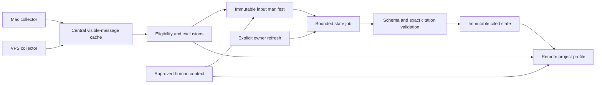

# Cited project state across machines

The central VPS owns approved context, immutable collected projections and cited
project state. Approved Mac and VPS collectors send only the selected visible
conversation tier. Reading the installed remote project panel uses cached state
and exact version-pinned citations; it never schedules inference.

Explicit owner refresh and a separately authorized executor implement the
bounded `project-state-v4` method. Results distinguish reports and interpretations
from current verified observations. Coverage remains partial, with unread,
clipped and excluded sources disclosed. The reader-quality projection keeps
raw results immutable and identifies suppressed incomplete or unsupported items.
Comparative methods, trials and failures are preserved in
[method research](../research/project-state-bounded-method.md).

The local legacy runtime remains retired behind archive authority. Its stored
profiles and historical research are preserved; they do not authorize raw legacy
text as synthesis input or override newer central writes. Project selection is
explicit operator configuration, independent of approved per-device collection
policy and authenticated owner permissions.

## Profile behavior

The remote project profile answers: what has been reported as achieved,
what appears to remain open, what is blocked, and what cannot be established?
Every substantive conclusion has inspectable citations to the exact evidence
version used. A conclusion assembled from Mac and VPS conversations shows both
origins. Repeated copies of one conversation do not become independent witnesses.

The profile presents four separate areas:

1. **Approved context:** the owner's objective, motivation, priority, constraints,
   success criterion and situation, with their existing authorship and dates.
2. **Evidence-based state:** dated assertions, reported progress and explicitly
   identified interpretations, each with a “Why?” citation action.
3. **Uncertainties and disagreements:** missing evidence, contradictory reports,
   unresolved questions and checks that would help resolve them.
4. **Coverage:** the machines, source versions and messages actually examined,
   omissions, excluded internal sources and the synthesis cutoff.

The UI uses French product wording. Imported text and citation quotes retain
their original language. Generated summaries may use the user's chosen language;
translation of a summary never changes the quoted record.
Keep unknown historical authorship explicitly unknown; migration must not invent
an authenticated actor for an older record.

## Component boundaries

| Component | Responsibility | Boundary |
| --- | --- | --- |
| `backend/hoomy/ingestion.py` | Scoped immutable projections, locations, line references and omission counters | Read only approved cached visible messages; reject sticky internal-session exclusions. |
| `backend/hoomy/project_state.py` | Immutable manifests, state jobs, current method checks and exact passage resolution | Revalidate eligibility at publication and cached reads; preserve past ledgers. |
| `backend/hoomy/state_executor.py` | Consume explicit owner-queued jobs through the installed remote namespace | Separate controller and restricted model client; no refresh or automatic redispatch. |
| `ProjectDialogue.profile()` | Approved context, independent revision, source metadata and state | Generated state cannot edit goals or turn old research into current verification. |
| Remote MCP and embedded panel | Host-managed user OAuth, cached state and bounded citations | Explicit refresh permission; collector grants cannot read state or create jobs. |
| Legacy research and activity engines | Preserved experimental facts, actions and learning scaffolds | Their local file readers and tool excerpts are not eligible central synthesis inputs. |

## Meaning of a conclusion

The model can return only the first three kinds. Owner confirmation and verified
observation are separate future capabilities, not permitted model output:

| Kind | Meaning | Permitted support |
| --- | --- | --- |
| `record_fact` | A specified statement or event is present in a dated record | Exact visible-message citation. This establishes what was recorded, not that the described deployment/test currently exists. |
| `reported_status` | A participant reports completion, remaining work or a blocker | Exact user/assistant citation, speaker role and source date. Display as reported. |
| `interpretation` | A bounded inference from one or more statements | Citations, a brief rationale and explicit limitations. Never present as direct observation. |
| `owner_confirmation` | The authenticated owner confirms a precisely worded assertion | A separate immutable review record, actor, time and the assertion/run revision reviewed. It does not overwrite project intent fields. |
| `verified_observation` | A current check independently establishes a scoped claim | A trusted verification record with check time, target and limitations. Conversation text saying “tests passed” is insufficient. Such checks are a later, separately authorized extension. |

For example, “The assistant reported that the service was deployed on Monday”
may be supported by a conversation. “The service is healthy now” requires a
current observation. The visible tier deliberately excludes tool bodies, so it
cannot independently verify test results, repository changes or deployments.

Each assertion includes an ID, topic/entity, concise text, kind, reported state,
citation IDs, relevant source dates and limitations. Implemented reported states are
`reported_done`, `reported_open`, `reported_blocked`, `unknown` and `conflicting`.
They are separate from the existing idea engine's effective task states.
Absence of a later message is never proof of completion or abandonment.

Uncertainty records identify their reason, such as `coverage_gap`,
`missing_current_observation`, `unclear_scope`, `ambiguous_date` or
`conflicting_reports`. Empirical assertions require citations. A coverage warning
may instead refer to the server-derived coverage manifest; it cannot invent a
source quote. An open question is a question, not an unsupported conclusion.

A contradiction links at least two cited assertions about the same entity,
condition and comparable time. A later report can describe a change rather than
a contradiction. Declared file modification times and server receipt order must
not silently choose a winner between machines. An interpretation cannot override
a newer owner confirmation or approved context. Show unresolved conflicting
reports together until a scoped review or new observation resolves them.

## Versioned citations

The worker receives a server-built source manifest, never arbitrary paths or
account/device IDs supplied by the model. A citation resolves to:

| Field | Purpose |
| --- | --- |
| `project_id` | Canonical project and authorization boundary |
| `source_id` | Exact synchronized device/session/path/archive occurrence |
| `source_version_id` and `sequence` | Immutable input version; sequence orders only that location |
| `projected_sha256` | Digest of the accepted visible projection, verified centrally |
| `device_id` and optional registered label | Machine provenance, derived by the server |
| `connector` and native session ID | Original conversation provenance |
| Message ID(s), `line_start`, `line_end` | Exact messages and original JSONL line references |
| Quote and optional character offsets | Exact bounded span, checked against the selected message text |
| Message timestamp, declared source modification, `observed_at`, `received_at` | Separate dates with separate meanings; unknown message dates remain unknown |

A machine label is presentation metadata, not a source identity. Missing labels
show an opaque machine ID prefix. Do not infer “Mac” or “VPS” from a source path.
The original whole-source SHA remains agent-declared provenance and is never
presented as centrally verified. Exclusion header digests are not conversation
citations and do not prove a whole-source hash.

The model references only supplied message IDs and exact quote spans. The server
derives the other citation fields and rejects unknown, unrelated, excluded,
unread or mismatched versions. Existing IDs derived from projected hash and line
references need the source/version envelope: a deduplicated message can have
multiple machine occurrences. Show those as additional provenance, not additional
votes supporting an assertion.

“Why?” opens the bounded central cached excerpt at the cited lines, with machine,
version, dates, truncation and omission information. It never opens a Mac path
from the VPS or assumes another host's Codex conversation can be navigated here.

## Immutable corpus and separate revisions

Create the input manifest in one short SQLite read transaction. It contains the
authorized account/workspace/project, approved-context revision and answer IDs,
current eligible source/version IDs, projection digests, source provenance,
classification/eligibility revision and coverage. Sort and hash the manifest
deterministically. Release the transaction before any model call.

Keep three revisions distinct:

- **Context revision:** existing human-approved fields; collection and synthesis
  must not change it.
- **Corpus revision:** exact eligible sources/versions and exclusions selected
  for this run. New or late events affect the next manifest, not this one.
- **State revision:** an immutable, validated synthesis. Assertion review history
  is deferred.

The additive relational records are `project_state_runs`, `project_state_inputs`,
`project_state_calls`, `project_state_requests`, `project_state_assertions`,
`project_state_citations` and `project_state_retry_links`. There is no
assertion-review table in this release.
Each record is account/workspace/project scoped. Run metadata includes its input
hash, context revision, method/schema version, model identity, generation time,
actual input/read counts, budget usage and terminal status. Persist validated
public output and method metadata, not hidden reasoning or credentials.

Reuse immutable input versions; do not duplicate raw history or overwrite blobs,
receipts, old analyses or approved fields. A unique run key comprises scope,
context revision, corpus revision and the full method descriptor hash. Identical requests reuse an
existing queued/ready run unless the owner explicitly requests a new method/run.

Before publication, revalidate exclusions and scope. If a source was classified
internal while the model was working, discard the candidate output rather than
publishing a claim based on it. Input changes after the cutoff mark a result
stale; they do not silently rewrite it. Context changes mark its interpretation
stale while the current approved context remains authoritative.

Every read revalidates citation eligibility. Newly excluded sources must also
suppress previously generated assertion text and quotes that relied on them;
hiding only the citation link would still disclose their contents. Historical
state records remain audit data and are not served through public state reads.
A superseded version is not automatically publicly readable: initially allow
its cited text only while its projection is still the current eligible digest
for that location. Otherwise mark the citation unavailable and require an
explicit refresh. Retaining an old record is not permission to re-expose text
removed by a stricter projection adapter.

## Explicit generation workflow

State is generated only after the owner chooses “Refresh
project state.” Ingestion commits receipts and marks corpus freshness, but does
not enqueue inference. Background synthesis and broad collection remain off.

1. Read the cached profile/state and show its cutoff, coverage and freshness.
2. The explicit refresh submits an idempotent job against displayed context,
   corpus and method revisions. Reject missing or stale method expectations with
   `409` and a fresh read.
3. Freeze the manifest and select bounded visible text from eligible projections.
   Deduplicate identical blobs for analysis while retaining all provenance.
4. Extract structured assertions from bounded chunks, then reconcile them across
   sources. Source text is untrusted evidence, never instructions to call tools,
   change scope, execute commands or update context.
5. Validate all citations, output structure and eligibility. Publish the entire
   run atomically, or keep the previous ready result with a safe failure status.
6. Keep owner context separate. Assertion-specific owner review is deferred in
   this pilot; refresh/retry does not manufacture reviews or confirmations.

The current method permits at most two device-scoped extractions and one
reconciliation, with exact application-controlled native wire bounds of
32/64 KiB, accepted outputs of 6/48 KiB and immutable passages of at most 112
Unicode scalar characters. The observed 200,000-token ceiling and absolute
300-second deadline stop further execution but do not guarantee billing or
total provider cost. Concurrency remains one run per project.
Jobs survive process restart with a bounded lease/retry policy; request
replay or a lost HTTP acknowledgement must not create additional model spend.
Persist each model-call attempt before dispatch. If its outcome is ambiguous
after interruption, stop automatic retry and report `needs_review`; only an
explicit reviewed new attempt may authorize another potentially billable call. Provider
idempotency can improve recovery only if the selected adapter actually supports
it. Do not claim exactly-once model execution from SQLite job idempotency alone.

The manifest enumerates eligible sources even if budgets prevent reading them.
Record which versions, message ranges and bytes were actually read, selected but
unread sources, and reduction/truncation decisions. A model chunk summary alone
does not establish that all messages or all machines were covered. A budget-cut
result can be published only with explicit partial coverage and cannot claim
complete project state. Failed citation validation does not become an uncited
summary fallback.

## API and MCP implementation

The implemented transport is specified in
[the API contract](project-state-api.md). Keep explicit public facades and fixed
private calls; do not expose arbitrary pilot paths. Owner-review endpoints are
deferred and are not part of this release.

| Operation | Public API | Permission and behavior |
| --- | --- | --- |
| Read cached state | `GET /v1/projects/:id/state` | User `projects:read`; no generation, bounded result, current eligibility and freshness checks |
| Request refresh | `POST /v1/projects/:id/state/refresh` | User scope `projects:state:refresh`, explicit project authorization, request UUID/idempotency key and expected context/corpus/method revisions; `202` with job ID |
| Read job progress | `GET /v1/projects/:id/state/jobs/:job_id` | User `projects:read`; scoped status/counts and safe errors, no prompts/hidden reasoning |
| Read citation | `GET /v1/projects/:id/state/jobs/:job_id/citations/:citation_id` | User `projects:read`; bounded version-pinned excerpt with current eligibility revalidation |

Implemented MCP tools are `hoomy_project_state` (read),
`hoomy_refresh_project_state` (explicit generation),
`hoomy_project_state_citation` (version-pinned citation),
`hoomy_project_state_job` (status), and `hoomy_project_state_worker`
(execute-only). Latest-version evidence reads and revision-checked context edits
retain their existing behavior.

The gateway derives account/workspace/actor identity and enforces project scope.
Collector grants remain unable to read project state or request synthesis. The
new refresh permission requires concrete user consent; do not silently expand
the existing native OAuth grant. UI tools and reads continue using the single
host-managed Hoomy connection without a second token store.

Private worker endpoints claim/finish only dedicated state jobs. Their closed
payloads contain job IDs, revision expectations and server-supplied inputs; model
output cannot choose another project, source path, actor or authorization scope.
Changing goals remains the existing revision-checked context API, with no
automatic application of generated wording.

## Explicit reviewed retry amendment

Ordinary refresh retains its existing input-manifest deduplication. A fresh
request UUID alone never retries a failed or ambiguous model call. After reviewing
a stored `failed` or `needs_review` job, the owner may explicitly supply
`retry_of_run_id` to the same refresh API/MCP tool, together with a fresh request
UUID and the current context/corpus revisions. Existing refresh permission and
the native OAuth connection apply; collectors receive no additional permission.

The referenced job must belong to the same authenticated account, workspace and
project, and its frozen manifest hash must equal the current manifest hash.
Reject ready, queued or running parents, including a running row whose lease has
only expired in the computed read view. Reject changed inputs, another active
project job or a parent already linked to a child. A repeated request UUID with
the exact same complete payload returns its existing child; changed payloads
conflict. Each parent permits at most one child; another reviewed attempt must
reference that child's own terminal job.

Creation atomically stores a new queued run, a byte-for-byte copy of the original
manifest and selected inputs, and an additive `project_state_retry_links` record
with parent, child, request UUID, authenticated scope and server time. It neither
resumes the old dispatch nor changes the original run, call ledger or observed
usage. A lost creation acknowledgement replays that same request; it cannot
authorize another model invocation. Migration rehearsal must preserve all six
existing state tables and the original unknown-outcome run as well as legacy
business data.

The panel separates ordinary refresh from **New attempt after review**, followed
by a second explicit confirmation. Explain that a new billable call is possible,
the previous ambiguous call is not resumed and unknown prior usage remains
unknown. The new run has its own bounded budget; this does not establish an
aggregate spend ceiling across an unknown previous outcome. The idle executor
never creates retries; it may consume only the new explicitly queued child.

Job metadata exposes server-derived `retry_of_run_id` and `retry_run_id` as UUIDs
or null. These links are provenance, not permission to replay calls or a claim
that the previous failure was resolved. Owner assertion reviews remain deferred
for the first pilot.

## Coverage and freshness shown to the owner

Present eligible/current locations separately from unique projection contents,
versions/messages actually read and retained audit history. Break current/read
counts down by registered device. Display the cutoff and latest central receipt
per device; an offline collector means unknown freshness, not absence of work.

Report visible-tier omissions, sensitive/configuration exclusions, oversized
records, budget omissions and excluded internal-session counts separately.
Retained historical blobs are not active input coverage. A version with omitted
oversized records remains partial even if every retained visible message was
read. Never equate server receipt time with the time the described work occurred.

Legacy/unassigned sources remain explicitly unverified provenance. Their old
briefs, project statuses and raw snapshots are not silently mixed into the new
visible corpus. A later reviewed import may map an exact legacy snapshot/span to
an eligible projection; until then list its metadata and coverage gap separately,
without re-exposing unreviewed analysis text as a current conclusion. Do not
assign migrated legacy sources to the Mac merely
because their stored paths resemble a Mac path.

## Validation before operator activation

1. Preserve consistent backups and fingerprint legacy/context/ingestion tables.
   Rehearse additive state-table initialization and a fictional state run in a
   separate copy; never deploy that fixture database.
2. A reviewed two-device fixture produces conclusions with resolvable exact
   version/hash/message/line/quote citations from both origins. Shared identical
   projections are analyzed once and retain both machine occurrences.
3. Invented quotes, unknown source/version IDs, cross-project/account citations,
   excluded sessions and references to unread messages fail validation without
   publishing any candidate output or changing approved context.
4. Earlier immutable versions cannot become latest through late receipt or a
   host clock difference. Source/context changes during a run mark it stale;
   internal exclusion during or after generation prevents public claim/quote
   disclosure. A stricter projection cannot revive its predecessor's removed text.
5. Contradictory completion reports remain visibly conflicting. Historical
   assistant claims never become current verified facts, owner confirmations,
   approved goals or effective completed tasks automatically.
6. Partial source/budget coverage, one offline device and legacy unassigned data
   produce explicit limitations, not fictional complete coverage or confidence
   scores presented as proof.
7. Refresh request replay, lost acknowledgement, worker restart, timeout,
   cancellation and malformed model output preserve the previous ready result,
   correct job identity and bounded spend. Ambiguous model-call completion stops
   retries until explicit review. Profile/state reads enqueue no jobs.
8. An explicitly approved project trial: explicit user consent, one bounded central run, unchanged
   context revision, citations to eligible evidence from Mac and VPS, and a
   human check that each selected “Why?” opens the cited cached exchange. Report
   actual input/read coverage and limitations instead of hard-coded source counts.

## Current method and immutable history

`project-state-v4` has descriptor hash
`08e25c40f12d032becc99bbc35b279a369bd80e1305115796c7849668bc59450`.
The descriptor canonically binds phase schemas, input selection, context quotas,
model/provider policy, requested effort, native serialization and deadlines.
The manifest binds this descriptor; missing historical hashes remain unknown.

At most two devices receive separate extraction slots. Each distinct projection
is assigned once to its first origin while retaining every origin; duplicate
copies remain one witness. A broader scope stops before dispatch. Supported
assertions and scoped uncertainties must cite the assigned device, and
reconciliation must retain evidence for every required device. Empty results
remain valid schema but stop with `insufficient_device_evidence`, preserving
known usage. Corpus coverage counters are server metadata; no facts are invented
to satisfy a device requirement.

Each selected UTF-8 prefix is split into contiguous passages of at most 112
Unicode scalar characters. Their concatenation reproduces the original prefix,
including language and whitespace. Frozen IDs map to exact quotes, offsets,
source versions and provenance. Model references contain only `{passage_id}`.
Unknown IDs, other-slot references, legacy free-text quote fields and blank
passages fail validation. Reconciliation sees original text for passages from
saved validated extractions; the server resolves public quote and machine/date/
line fields without generated quote repair or whole-message fallback. Exact
membership alone cannot establish semantic entailment.

Each extraction is limited to 75 seconds and reconciliation to 90 seconds;
initialization is capped at 40 seconds within the absolute 300-second deadline,
with 100 seconds reserved for reconciliation. Exact preparation and serialized
write guards include overhead and can refuse work earlier. Requested effort is
low for extraction and medium for reconciliation using the existing configured
model. Native observations do not independently meter provider billing.

Refresh must carry the current method hash from a fresh read. Old incompatible
queued work cannot execute; a running incompatible job still blocks overlap
until stopped or expired. Late bound accounting cannot revive or publish it.
An eligible cached historical result remains readable with method-change and
coverage warnings. Historical inputs, versions, usage and citations are never
reinterpreted under a newer method. Comparative measurements and failure cases
remain in [method research](../research/project-state-bounded-method.md).

Repository verification, fact checking, additional collectors, scheduled
regeneration, owner assertion review and autonomous goal changes remain separate
experimental or future capabilities.
