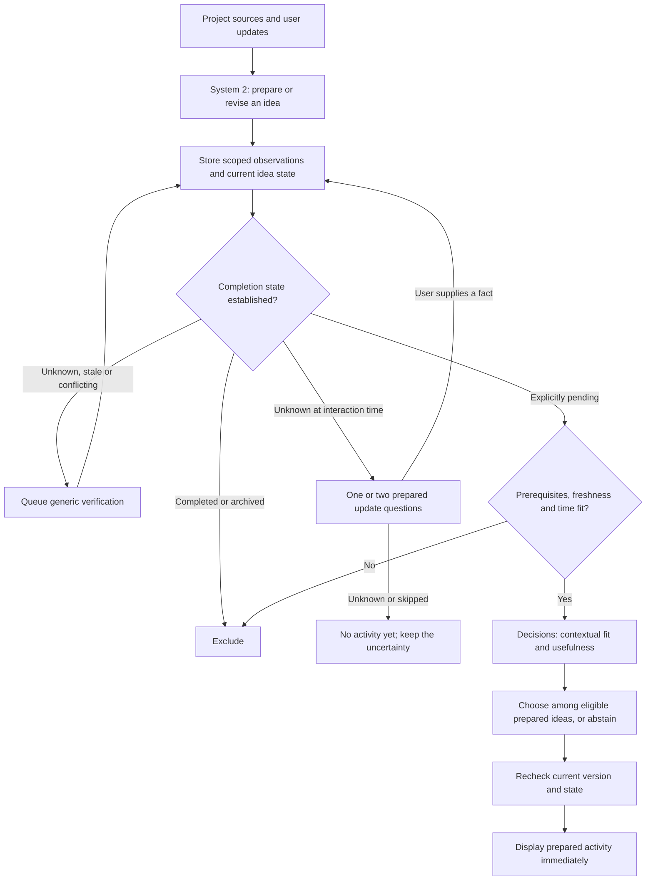

# Experiment 008 — Prepared ideas and fast decisions

Runtime follow-up: [experiment 009](009-question-pool-and-recovery.md) supersedes the
initial question routing, manual preparation UX and single fast-worker design below.

Date: 2026-10-07. Status: first desktop integration implemented and fixture-tested.
The earlier architecture below is retained as a design target; the implementation
and its limits are specified in the next section.
Predecessor: [experiment 007 retrospective](007-rex-20261007.md).

## Integrated slice and retest protocol

`ReadyIdeasView` replaces the blocking **Pour maintenant** screen. Existing Discover
projects and Act history remain intact. Historical candidates are imported once as
unknown; exact prior completion confirmations stay completed, and a previously
rejected candidate without a state fact is archived. No new human answers are invented.

1. Open **Pour maintenant** and state the available time. An unknown candidate may
   appear immediately as a blue state question, never as an actionable suggestion.
2. Answer **Déjà fait**, **À faire et possible**, **Bloquée**, **Je ne sais pas** or
   **Passer**. Answers commit locally before another selection. At most two questions
   are asked per interaction. Passing creates no completion observation.
3. **Qu’est-ce qui serait utile ?** filters known, fresh, feasible pending work and
   makes one Decisions choice among at most eight ideas or abstention. A green activity
   card shows the measured selection duration. No source investigation runs here.
4. If nothing is ready, **Préparer des idées** explicitly queues the existing slow
   Codex retrieval, generation and generic verification path. Selection remains usable
   during preparation. Preparation errors and cancellation are visible.
5. **C’est maintenant terminé** removes the idea immediately. **Donner mon retour**
   separately records usefulness and attention. Completion is a project fact, not a
   usefulness score. Future preparation includes prior feedback and the prepared pool.

### Actual storage and code

All new records use indexed identity/status columns plus a JSON payload in the same
private SQLite database. Reset deletes observations and selections before ideas.

| Record | Stored fields and lifecycle in this slice |
| --- | --- |
| `ideas` | `id`, `project_id`, frozen `candidate` (action, completion criterion, predictions, source refs), `version=1`, `revision`, `state`, `confirmed_at`, `valid_until`, `snoozed_until`, `scope_key`, `origin_request_id`, evidence pointer. Identity hashes project and normalized exact completion criterion. Revised text is not silently substituted. |
| `idea_observations` | Append-only `id`, `idea_id`, `idea_version`, `state`, `source`, `observed_at`, `valid_until`, `evidence`, `supersedes_id`. Human pending explicitly confirms feasibility too. The source request retains full bounded agent verification evidence. |
| `idea_jobs` | Fast selections: `id`, `status`, absolute deadline, context, frozen eligible IDs/versions/revisions, provider answers/usage/timing, result or safe failure. A stale result cannot publish an activity. Slow preparation continues to use `act_requests`. |
| `act_requests` | `purpose=prepare_ideas` for preparation; `policy=ready-ideas-v1` for a delivered choice, with idea/version/revision, evidence pointer, origin request and Decision trace. Existing feedback and metrics remain available. |

`hoomy/ideas.py` owns storage, the deterministic gate, questions and race checks.
`hoomy/idea_worker.py` polls fast jobs on a dedicated host thread, independent of slow
Codex work. `hoomy/decisions.py` calls the official API with strict result validation.
`hoomy/act_verification.py` asks the agent to choose a relevant verification; no domain
check catalog is introduced. Verification must match the exact candidate, project and
criterion, report a current direct observation with successful tool evidence, and
establish feasibility to create pending state. Historical text stays unknown. This
still relies on the agent's semantic interpretation of evidence, not a formal proof.

The local gate runs before the API call, before delivery, and on subsequent reads.
Unknown, stale, completed, blocked, snoozed, out-of-scope and over-budget ideas cannot
be shown as ready activities. A human pending confirmation lasts 24 hours; a direct
agent observation lasts one hour. Completed remains terminal. Expiration never
reactivates completed work. A changed answer increments the revision, invalidating
in-flight selections; late verification cannot overwrite a newer human confirmation. A fresh direct check
can resolve a previous human “unknown” without asking the same question again.

Current API: `GET /api/now`; `POST /api/now/choose`, `/answer`, `/prepare`.
Host-only queue protocol: `GET /api/now/work`; `POST /api/now/claim`, `/finish`.
Preparation cancellation still uses `/api/act/cancel`. None of the GET routes runs
inference. The native screen polls fast work at 150 ms while selecting and otherwise
at 1.5 s. The backend rejects results after three seconds; socket timeouts are two
seconds with no automatic retry. This bounds accepted UI work, not all possible OS
DNS/transport stalls. A timeout displays an honest empty state.

### Credentials and rollout

The host reads a local `decisions-config.json` in
`~/Library/Application Support/HoomyPilot`, containing only a `key_file` path to the
user-authorized dotenv. Only `OPENAI_API_KEY` is parsed. It is not copied into the
repository, Docker, SQLite, Swift or the Codex subprocess. The key is sent only to
`api.openai.com` with certificate verification enabled. Decisions receives the current
request and compact eligible candidate summaries; Codex still uses its existing login.

A private SQLite backup is made before migration. The live database is never replaced
with a fixture. Restart through `python3 backend/run.py start` rebuilds the backend and
Swift bundle; quit the previous app process first. Old trial records must compare
unchanged after restart. A disabled treatment/scope still prevents selection.

### Integrated validation and remaining limits

The live rollout preserved all **15 projects and 4 prior trials**, with exact before/after
comparison of project and trial records. The migrated pool contains six ideas: three
unknown, two completed and one archived. No synthetic answer or API choice was added
to the live database. The backend is healthy and the host worker and rebuilt app are
running. Final visual reinspection on the live database was unavailable while the Mac
was locked; native fixture UI validation was completed before locking.

- Python: 191 tests run (190 passed, one skipped), including unknown/stale/completed exclusion,
  concurrent completion, stale answers, deadlines, consent, exact evidence matching,
  migration idempotency, reset, parallel preparation and visible preparation failures.
- Swift: 17 tests passed. Native UI was exercised against an isolated fixture service
  with the real Decisions API: question/confirmation, selection and immediate removal
  after completion. The live project database was not used for synthetic answers.
- The updated Codex verification schema was exercised on an isolated current-state
  file: one successful tool observation, `contradicted / current_observation /
  satisfied`, in **13.68 s**. No actual project files were read or changed.
- One HTTP/worker/API loop took **2.075 s** end to end (**1,780.95 ms** provider call).
  A second native selection displayed **1.94 s**. These are individual smoke results,
  not p95 measurements or a speed guarantee. Private test artifacts remain in ignored
  `pilot/runtime`; no real conversation was submitted during these synthetic tests.

This first slice uses a single choice call, not the proposed classification/ranking
cascade or cache. Questions use a fixed UI template over each stored exact criterion.
The pool is prepared manually; app opening does not schedule inference. No automatic
source-change invalidation, semantic deduplication, conflict reducer, recurring-task
version workflow or learning of model weights exists yet. Completed facts influence
future preparation through the pool; measured impact/attention feedback influences
that preparation through the existing history. Fast ranking uses prepared predictions
and current constraints. Two unanswered questions may legitimately leave no suggestion.

The principal next measurement is real-use click-to-card latency and the rate of
already-completed suggestions, compared with experiment 007. Record cold preparation
separately. Do not declare learning progress before actual completed-activity feedback.

## Hypothesis and product invariant

A useful proactive assistant prepares its knowledge before the user asks. At login
or “What would be useful now?”, it should select from known pending work, or ask
one or two short state questions. It must not show an activity whose completion
state is unknown. Lack of completion evidence is not evidence of pending work.

Separate the slower investigation and idea generation path (System 2, existing
Codex agent) from a fast selection path (System 1, local policy plus Decisions).
System 1 does not invent new activity text at interaction time. System 2 prepares
ideas, exact completion criteria, bounded actions, questions and evidence; System 1
checks and selects them. This moves uncertainty handling before the suggestion.

## Verified API fit

OpenAI released Decisions in public beta on 6 October 2026. It uses
`POST /v1/decisions` and currently supports `gpt-6-luna`. It returns predicates,
choices or scores, rather than generated activity prose or tool calls. Independent
questions can share one request; dependent stages need another request. The
advertised speedup is not an application-level latency guarantee.
[Official guide](https://developers.openai.com/api/docs/guides/decisions),
[release log](https://developers.openai.com/api/docs/changelog).

Each request supplies `model`, shared `input` and named `questions`. Handle per-question
refusal, missing answers, timeout and invalid choices as abstention. Choices return
probabilities and confidence; scores are weighted level indices. These numbers do
not constitute proof of task status. Evidence gathering and tool execution remain
in the Codex path. [API reference](https://developers.openai.com/api/reference/resources/decisions/methods/create).

## Target decision flow (beyond the first slice)

The same local eligibility gate runs before ranking and immediately before delivery.
A different final candidate needs its own valid evidence. A high model score cannot
bypass this gate, and follow-up depth never changes it. An unresolved fact becomes
a question card, visibly distinct from an activity card. No recursive investigation
or activity generation is allowed on the user-facing fast path.

## Minimal persistent structures

The proposed additions stay in the existing SQLite database, after an additive
migration and backup. The broader target below includes fields and workflows not yet implemented; see the
integrated storage table above for the current contract.

| Structure | Minimum fields | Purpose and lifecycle |
| --- | --- | --- |
| `ideas` | `id`, `project_id`, `version`, `origin_request_id`, `action`, `completion_claim`, `attention_minutes`, `benefit`, `preconditions`, `state`, `state_revision`, `prepared_question`, `snoozed_until`, timestamps | Stable identity across requests. State is a projection of evidence, not a generated assertion. Text or criterion changes create a new version. |
| `idea_observations` | `id`, `idea_id`, `idea_version`, `predicate`, `value`, `source_kind`, `evidence_ref`, `observed_at`, `valid_until`, `supersedes_id` | Append-only dated evidence. Separate completion from prerequisite observations. User corrections preserve what was believed before. |
| `idea_jobs` | `id`, `idea_id`, `idea_version`, `expected_state_revision`, `kind`, `status`, `lease_until`, `dedup_key`, `next_attempt_at`, result/error | Durable bounded preparation/verification queue. Prevent repeated checks; discard stale results after a human update or version change. |
| Existing `act_requests` | Add `idea_id`, `idea_version`, `state_revision`, `context_hash`, `eligible_ids`, `decision_answers`, stage timings, `policy_version` | Record what was eligible, what was asked and why a prepared idea was selected. Preserve user feedback and prediction comparisons. |

Before creating an idea, preparation checks the existing pool, including completed
ideas, for the same project, target and completion criterion. Rewording a title is
not a new task. Store a canonical idea ID and resolve possible duplicates during
preparation; ambiguous identity prevents readiness rather than inheriting another
idea's verification. Recurring work requires an explicit new occurrence/target.

`state` separates **pending / completed / unknown / conflicting**. Expired evidence
makes effective state **stale**, requiring an update. Eligibility is computed; it
must not be represented by a persistent `ready=true` flag that can silently go stale.
Archived and snoozed are lifecycle controls, not claims about completion.

The prepared question belongs to an idea version and a missing predicate. It stores
its wording, possible answers and the exact state update each answer permits. No
new question table is needed initially. “Already done”, “Still pending”, “I don't
know” and “Skip” are distinct; skip changes no fact. An answer takes effect locally,
without a new generative call. Two questions are a ceiling, not a mandatory funnel.

### Evidence rules

- Only an explicit user declaration or a relevant successful direct observation can
  establish pending work. Historical text can identify a lead, but never pass the gate
  simply because no later success was found. A successful tool invocation alone is
  insufficient: its observation must support this exact criterion and version.
- Evidence and prerequisites carry freshness and provenance. First experiment policy:
  pending declarations last at most one day, and source changes, task starts or
  corrections invalidate them earlier. This is an experimental bound, not an accuracy
  guarantee. Time-sensitive observations may have shorter validity.
- Completed is terminal for that version. Expiration never revives it. Explicit
  reopening, recurrence or a new target creates a new version with unknown state.
- A newer statement only supersedes an older one for the same predicate and scope.
  Unresolved disagreement blocks suggestion. Human correction invalidates pending
  verification jobs and selection caches.
- A source update can invalidate existing evidence cheaply before any background
  reclassification. External changes Hoomy cannot observe remain a stated limitation.
  “Known pending” always means supported as of the recorded observation.

## A short funnel, not a long serial questionnaire

**Preparation stage, off the critical path:** gather a compact evidence packet per
idea. Decisions can classify independent questions together: what completion state
is supported; whether the evidence applies to this criterion; whether prerequisites
are resolved. Missing evidence schedules generic Codex verification or prepares a
human question. Observation reference and source validity are checked in code.
Decisions classifications are proposals, never self-authenticating observations.

**At login/request:** immediately read the local prepared state. Deterministically
exclude completed, stale, unknown, blocked, snoozed and over-budget ideas. If a needed
fact is missing, show the highest-value prepared question, then at most one more.
Don't make the human answer several low-value questions just to fill the pool.

**Fast evaluation:** evaluate current-context fit and useful progress together over
compact eligible summaries. Return at most three possibilities. A final `choice`
question can select one eligible ID or `abstain`; when a cached valid ranking or a
single clear candidate suffices, skip that call. The action, evidence caption and
bounded explanation are already prepared: no final prose-generation call.

Cache decisions by idea version, state/evidence revisions, context hash and policy.
Re-read those revisions and current validity before delivery. A concurrent completion
must prevent a late response from displaying the now-completed activity.

## Proposed code boundaries

| Component | Responsibility |
| --- | --- |
| `hoomy/ideas.py` (new) | SQLite identity, versions, observation reduction, corrections and atomic eligibility reads. |
| `hoomy/idea_worker.py` (new) | Bounded durable jobs using existing retrieval and generic Codex verification. |
| `hoomy/decisions.py` (new) | Small typed API adapter, strict response validation, deadlines, no agent tools. |
| `hoomy/decision_policy.py` (new) | Deterministic gate, caching, question selection, ranking and late-result rejection. |
| `hoomy/act.py` | Keep request/feedback history; select prepared ideas rather than launch full investigation. |
| Swift `ActLearnView` | Render `activity`, `question`, `preparing` or `none` explicitly; answer updates are immediate. |

The isolated prototype under `backend/experiments/decision_ready/` exercises the adapter
and policy. The integrated slice consolidates policy into `ideas.py`, reuses the existing slow
queue and uses `ReadyIdeasView`; caching and the broader scheduling design remain future work. The production agent model stays unchanged;
only the Decisions experiment uses `gpt-6-luna`.

Original suggested API boundary (superseded by the integrated routes above): `GET /api/now` reads prepared state without inference;
`POST /api/now/choose` allows a bounded fast decision; `POST /api/ideas/{id}/answer`
requires idea version and expected state revision. Reply with the next question or
activity immediately after the local transaction. `POST /api/ideas/prepare` queues
a preparation pass; consent, pause and scope controls still apply.

Begin with a manually triggered preparation pass. Later add debounced source-change
and app-open triggers with explicit budgets. App-open serves available cards first;
it never waits for preparation to finish. No desktop automation was scheduled here.

## Measured prototype and limits

Ten real Decisions requests evaluated fictional compact cases on 7 October:
median **287.58 ms**, minimum **192.89 ms**, maximum **1,471.43 ms**. Connection was
reused. The cases made three independent questions per request, totaling 8,068 input
tokens. Nine completion labels matched expectations. The expired-pending case was
misclassified as pending; the deterministic gate excluded it. Zero ineligible ideas
passed the local gate. This small fixture set is not a calibrated quality evaluation.

The initial route also required completion confidence >= 0.9 after an explicit
human pending declaration; it unnecessarily abstained on the eligible case (0.83).
The revised policy treats stored validated state as authoritative and uses Decisions
for contextual choice. Replaying the same responses admits that eligible idea while
preserving all exclusions. The published result records both routes; these are not
additional API observations. Do not tune a “truth probability” threshold to replace
provenance or keep re-questioning an explicit human answer.

A separate final choice between two eligible fictional ideas took **712 ms** and
selected the documented release prerequisite. It used 350 input tokens. This
confirms endpoint access and basic routing, not production UX latency. The 10-call
series and separate choice must not be presented as a measured end-to-end funnel.

The classifier/local-route and final-choice measurements each have a private
observation report (not exported). Their aggregate findings are retained above.
The API key was read only from the user-authorized local dotenv file, never printed,
copied to the repository, passed to Codex, or added to the app. TLS verification stayed
on. No private conversation data was sent in these calls.

## Original execution plan and acceptance criteria

1. Add stable ideas and observation history in an isolated database copy. Import
   candidates as unknown. Reuse old confirmations only when their exact criterion
   and project are mapped; ambiguous semantic matches remain unknown.
2. Prepare a small pool for one project, with generic verification and reusable
   questions. Persist provisional as well as final candidates, observation scope,
   token usage and every stage's elapsed time.
3. Replace the blocking request flow with the state gate and prepared-card UI.
   Remove the follow-up confirmation override. Connect the fast Decisions adapter.
4. Shadow-test against the recorded failure patterns and real updates before making
   this the default. Compare local cached, network decision and cold preparation paths
   separately; a shorter classifier call is not yet a better recommendation.

Targets, not achieved desktop measurements: cached card visible in <200 ms; fast
selection p95 <2 s once prepared; a hard interaction deadline with a prepared question
or honest empty state instead of waiting on System 2; at most two update questions.
Use an end-to-end timer and network cancellation, not just a per-socket timeout.
Preparation has separate time/token/job budgets and cannot retry continuously.

Release blockers: any unknown/completed/stale idea displayed as work to do, any
cross-idea verification reuse, or any answer racing a newer correction. Measure
false suggestions, inappropriate abstentions, unnecessary questions, completed-task
corrections, readiness coverage, freshness, click-to-card latency and useful activities
actually performed. Keep impact/attention learning separate from completion state.
