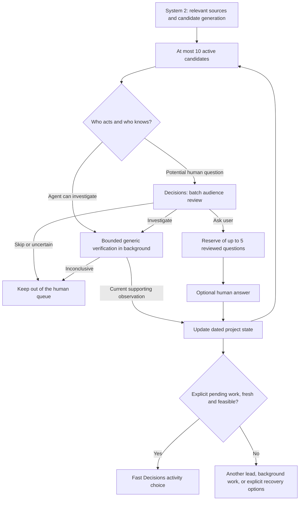

# Experiment 009 — A bounded question pool and recovery from uncertainty

Date: 2026-10-07. Successor to [experiment 008](008-ready-ideas-decisions.md).
Policy: `ready-ideas-v2`. This is an evolution of the same local pilot and database.

## Observed failure

The user answered an Ekoalu question with “unknown” because the state depended on
other people, then skipped a Hoomy question that appeared to be a coding-agent
intermediate task. Both candidates were snoozed for 24 hours. No preparation was
queued. The next choice was empty; Refresh only reread the same empty state.
Responsibility had never been checked before turning an unknown into a human question.

A subsequent explicit preparation failed. The previous worker kept only a generic
error, so its exact cause is unavailable. A read-only replay of that same request
completed in 71.2 seconds. This does not establish the original cause or prove the
failure cannot recur. The new worker records stage, safe failure category and request
ID, and presents a recovery path for both empty and failed results.

The unrelated Discover menu was also present on the activity screen. It is now
restricted to **Mes projets**, renamed **Outils de découverte**, and sized to its label.

## User-facing loop

- **Trouver une activité** first uses eligible prepared work or a previously reviewed
  question. If the pool cannot serve the request, it starts one background preparation
  and displays its actual stage. The same interaction resumes when preparation finishes.
- The interface no longer requires Refresh or a separate Prepare button. After an
  inconclusive result, **Chercher d’autres pistes**, **Choisir un projet**, and
  **Préciser mon objectif** remain explicit options. A failed request uses the same path.
- **Questions prêtes pour toi** exposes up to five reviewed questions for the matching
  request context. The person chooses which to answer. Guided selection still asks
  at most two questions per interaction; the reserve is not a mandatory questionnaire.
- **Je ne sais pas**, **Dépend d’un tiers**, **À vérifier par Hoomy**, and **Passer** are
  distinct. Routing corrections persist separately from completion and usefulness.
  None is converted into a claim that the underlying task remains undone.
- Existing facts, trials and feedback remain preserved. The two routing corrections
  applied during rollout came directly from the user's current messages.

## Preparation and decision flow

System 2 generates `actor`, `state_owner`, `state_question`, and `question_reason`
with each candidate. Actor and state owner use `user | agent | external | unknown`.
This is a responsibility model, not a catalog of domains, tools or skills. Historical
candidates missing this metadata cannot immediately become human questions.

Decisions reviews independent audience questions in one batch, sharing current context,
compact user evidence excerpts, the candidate questions and previous routing answers.
It returns `ask_user | investigate | skip` per candidate. The generator's rationale is
an assertion to scrutinize, not proof. An approved audience decision is never completion
or pending-work evidence. Tool observations or explicit human confirmation remain
necessary for the activity gate.
Questions in this slice confirm the exact completion claim and use done/pending/unknown
replies. Open-ended preference questions require a different answer model and are not
admitted to this state-confirmation interface.

Approved questions are cached for one hour against exact idea version/revision and
request context. A different request, a human correction or a changed question invalidates
approval. Candidate and scope are checked again before delivery. Up to five approved
questions are exposed; additional approved candidates stay in the bounded reserve.
The model can still misjudge answerability. The product keeps routing corrections visible
and does not promise that five suitable questions always exist.

## Bounds and lifecycle

- At most **10 active candidates globally** in the current visible project scope. Older
  excess candidates are parked (`pool_active=false`), not deleted. Known pending work
  is retained first; archived/completed records do not consume this active budget.
- Up to **5 reviewed questions** are shown for the prepared context. No quota filling.
- **One automatic preparation per interaction**. Follow-up answers retain that budget.
  An explicit new search can start another pass. Concurrent identical preparations
  are shared; preparation for a different request is not silently reused.
- Each candidate gets at most **one queued generic verification attempt** in this slice,
  with a **45-second** agent budget. An inconclusive check stays unresolved. The queue
  does not retry forever or automatically reset its budget on an unknown observation.
- A foreground search takes priority over an optional background check. Persisted due
  checks wake the idle host worker even when no suggestion request is queued.
- Cancelling a preparation stops queued background checks too. Consent, scope and
  Discover pause rules continue to apply. Opening the app reads state and does not
  initiate new generation; already-authorized background work may continue.
- Decisions has separate host threads for activity selection and question batches.
  An activity result must arrive within **3 seconds**; the background batch has an
  **8-second** acceptance deadline. Transport socket timeouts are 2 and 5 seconds.
  These are bounded acceptance policies, not OS-level cancellation guarantees.

## Minimal data changes

| Record | Added data | Meaning |
| --- | --- | --- |
| Candidate | `actor`, `state_owner`, `state_question`, `question_reason` | System 2's proposed ownership and human question, supported by source references. |
| Idea | `actor_override`, `state_owner_override`, `last_answer`, `pool_active` | Explicit human correction and bounded pool membership. Delegating verification changes the state owner, not necessarily the actor; legacy `routing_override` remains readable. |
| Idea | `question_review` with decision, job ID, context, expiry and version/revision | Cached Decisions audience assessment. Superseded assessments remain in job traces. |
| Idea | `verification_due`, `verification_attempts`, `pool_context` | Durable bounded background work. Human updates invalidate stale verification results. |
| `idea_jobs` | `decision_kind=question_batch`, candidate snapshots and named answers | Reproducible batch input/output, separate from project facts. |
| `idea_jobs` | `preparation_id`, `recovery_attempted`, `recover` | Continue the same interaction once without an unbounded investigation loop. |
| `act_requests` | `purpose=verify_idea`, target idea/revision; `progress_stage`, `failure_code` | Reuse the existing agent queue, expose real stages and retain safe diagnostics. |

No extra database service or task-domain-specific checks were added. The API additions
are described in [the pilot contract](../../backend/CONTRACT.md).

## Validation

200 Python tests run: 199 passed, one skipped. 18 Swift tests passed. Added cases cover
batch admission, human corrections racing the batch, completion remaining unknown after
approval, ten-candidate/five-question bounds, one recovery pass, shared preparations,
cancellation, responsibility feedback, idle background dispatch and error diagnostics.

An integrated run completed in 33.31 seconds but produced no new candidate. The UI
displayed recovery options instead of an inert empty screen. This exposed overly
conservative pool generation: an uncertain lead may be prepared for investigation;
only delivery as an activity requires pending-work evidence. The preparation prompt
now makes that distinction explicit without requiring a fixed number of candidates.

Two legacy background checks exposed a separate failure: old candidates omitted
`needs_confirmation`, and the host did not transition a rejected result out of
`running`. Legacy candidates are now normalized, results are validated before submission,
and backend rejections produce a safe `result_rejected` diagnostic. The two stuck
checks were closed as failed; no project completion or user assessment was fabricated.

The final real preparation completed in **56.23 seconds**, produced one new human-owned
lead, and its audience review completed in **1.722 seconds**. The reserve then contained
four active candidates and one approved question; no activity was marked pending. A
second identical request reused the reviewed question in **17.48 ms** at the local API,
without another model job. This
demonstrates the cache path, not a guarantee of five useful questions for every context.
All 15 projects and the five pre-existing requests, including their feedback and
confirmations, were preserved across the final restart.

The native interface was checked through preparation and recovery: the unrelated menu
was absent and explicit next options were visible. The Mac locked before the final
post-build visual check; final service checks used the same local APIs as Swift.

A real Decisions batch over three fictional cases completed in **1,869.21 ms**:

| Case | Decision |
| --- | --- |
| Personal choice based on designs the user had already compared | `ask_user` |
| Intermediate coding-agent note that the user explicitly does not know about | `investigate` |
| Supplier-owned status that the user cannot know | `skip` |

This is a smoke check, not a calibrated accuracy benchmark. The previous preparation
failure remains unexplained because its original diagnostic was not stored. Real-use
validation should measure irrelevant questions, unnecessary repeated questions, time to
first useful card, useful actions performed, and pool exhaustion separately.
