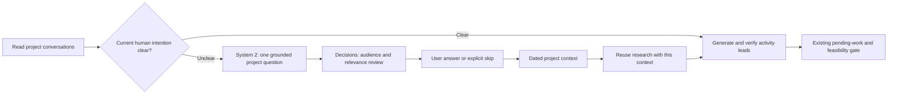

# Experiment 010 — Research restitution, project intent and visual inspection

Date: 2026-10-07. Extends [experiment 009](009-question-pool-and-recovery.md).

## Observed problem

The user's all-project search took 86.66 seconds and returned no activity. It had
read eight conversations and obtained one current observation, but the interface
hid the rationale, uncertainties and evidence behind a generic empty label.

The subsequent FutureYou search took 67.31 seconds, followed by a 22.6-second
background check. Both focused on whether an old data-conversion task was complete.
The environment did not permit a successful observation. Neither established why
this project mattered to the person now. Treating a historical technical task as
the current project goal led to another dead end.

The first implementation trial of this change still spent 72.97 seconds on that
technical uncertainty. Adding an optional intent question to the activity prompt
was insufficient. This prompted a structural change: clarify missing intent before
generating or verifying technical activity candidates.

## Revised interaction

1. During research, show the conversations actually read and the current stage.
2. Always return a short research summary, specific unresolved points, and the
   dated sources. Historical results expose the rationale and uncertainty they
   already stored; they are not retroactively rewritten.
3. If no dated human goal, motivation, priority or success criterion is available,
   System 2 first examines current intent from the conversations. A historical task
   or Discover description is insufficient on its own. It can ask one grounded
   question, or explicitly explain why an intent question is unnecessary or unsafe.
4. Decisions reviews that question for relevance, answerability and ownership.
   Technical homework and external unknowns remain excluded. The question is bound
   to sources from the identified project, with an explanation of what its answer
   changes. This is a distinct open-answer interaction, not the done/pending buttons.
5. The user can use a suggested option, write freely, say they do not know, or skip.
   Saving an answer resumes the same interaction with the already-read excerpts.
   Their original timestamps remain intact. The response does not create a
   completion fact, pending activity or usefulness assessment.

The existing two-question interaction limit and ten-candidate active pool remain.
The additional question is a single project-level clarification per research result;
it does not create an unbounded queue of activity candidates. Unknown and skipped
answers are persisted to prevent repeatedly asking the same question.

## Visual research explorer

**Explorer cette recherche** opens a native interactive graph. Its columns show the
request, conversations, candidates, state/checks, and decisions/questions. Clicking
a card reveals its persisted evidence, finding, uncertainty or decision. Connections
come from source references and stored request links; they are not a reconstruction
of hidden model reasoning.

The header explicitly distinguishes current work, queued checks and idle waiting.
The graph updates while work continues. Historical searches remain inspectable.
The outcome node explains an empty result, and an approved intent question points
back to the main screen for answering. Internal verification-only records no longer
appear as separate failed activity suggestions in the main history.

Users can attach a free-text comment to a specific node and project. Comments enter
the next inference snapshot as dated research feedback. They do not silently mutate
task status or become evaluations of completed activities. No inference runs merely
because the explorer is opened or refreshed.

## Minimal persisted data

| Record | Fields | Meaning and lifecycle |
| --- | --- | --- |
| `act_requests.research` | `summary`, `unresolved`, nullable `question` | System 2 restitution from the actual research; retained with that request. |
| Project question | `project_id`, `dimension`, `prompt`, `why`, `changes_decision`, `options`, `source_refs` | One motivation/goal/priority/constraint/success question with project-bound evidence. |
| `context_question_review` | decision, time, job ID | Decisions admission trace, separate from project truth. |
| `project_context_answers` | ID, project/request IDs, dimension, exact question/answer, response kind, answer date, superseded ID, scope | Append-only human context; latest statement per project/dimension enters subsequent prompts. Unknown/skip stay explicit. |
| `research_feedback` | ID, project/request/node IDs, node title, exact text, date, scope | User feedback on a specific research step; latest 20 relevant comments enter the next request. |
| Request input snapshot | `project_context`, `research_feedback`, optional `research_seed` | Reproducible inputs; reused source dates are preserved. |
| Progress | `progress_stage`, `progress_sources` | Actual stage and read-source inventory for the running UI. |

Both new tables live in the existing private SQLite database and are cleared by the
existing explicit reset flow. Scope and generation checks prevent old-scope answers
or research feedback from entering new inference. Raw user wording remains unchanged.

## Validation and limits

Offline tests cover open-answer persistence and reuse, no fabricated completion,
unknown/skip handling, source/project validation, scope changes, intent before tools,
progress visibility, graph links and feedback reaching the next prompt. Swift tests
cover the additive wire format and distinguish an intent answer from an activity.

The final FutureYou run stopped at orientation and returned a grounded question about
what the structured data should enable for the person. Preparation took **22.90 s**;
Decisions admission took **1.557 s**. Reopening the same context returned the approved
question in **9.80 ms** at the local API, without new inference. No answer was supplied
on the user's behalf. The historical 86.66-second search produced an inspectable graph
with **14 nodes and 21 valid links**. Existing requests and user feedback were preserved.

An earlier orientation response was rejected by validation. Project/source identifiers
are now constrained in the generation schema, with at most one bounded format repair.
A failed search displays its own read inventory and failure rather than reusing the
previous search's report.

The Python suite ran 211 tests: 210 passed and one skipped. The native build and
20 Swift tests pass. The Mac remained locked during the attempted final visual check;
live-service integration and graph data were checked, but final visual review remains
to be completed when the desktop is unlocked.

Intent review still depends on model judgment. This experiment makes uncertainty
inspectable and actionable; it does not guarantee a useful activity for every request.
The research explorer remains a local diagnostic view, not a new source of truth.
