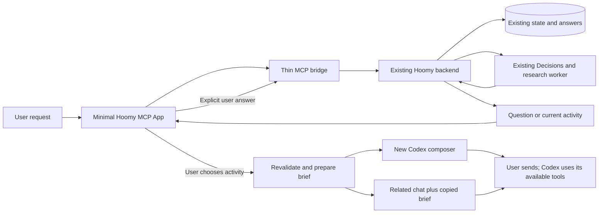

# Experiment 011 — A minimal Hoomy entrypoint in Codex

Date: 2026-10-08. Follows the [experiment 010 retrospective](010-rex-20261008.md).
Status: local plugin installed; bridge, preview and native global opening verified.
A real user handoff remains an acceptance check.

## Hypothesis

Hoomy can become a small entrypoint to useful work inside Codex. A single request,
one relevant clarification at a time and a preserved handoff should remove the
need to navigate the separate pilot application. The first test isolates this UX
change while keeping the existing suggestion engine and durable state.

This test does not establish that research is faster, that the suggestions improve,
or that Hoomy is proactive. Those require separate observed usage.

## Scope

| Keep | Add | Defer |
| --- | --- | --- |
| Discover projects and current pilot database | Global MCP App entrypoint declaration | New discovery UI |
| Decisions routing and Codex SDK research worker | One compact request/question/activity screen | Moving pre-suggestion research into native Codex |
| Evidence, expiry and unknown-state handling | Read-only activity brief with related chat links | Automatic chat messaging |
| Project intent answers and question limits | Skill for continuing the selected activity | Proactive scheduling and full desktop UI parity |

The implementation is in [`plugins/hoomy`](../../plugins/hoomy/README.md). No Swift
or existing inference code changes are part of this experiment.

## Data flow

No additional database is introduced. The UI retains only its selected job ID and
form state in memory; the backend retains the request, answers and evidence. On
reopening, the user can explicitly resume the latest request. Polling only reads
state and does not restart research.

The bridge exposes six tools: `hoomy_home`, `hoomy_choose`, `hoomy_answer`,
`hoomy_cancel`, `hoomy_retry` and `hoomy_handoff`. The last operation is read-only. It verifies
that the backend still exposes a ready activity, carries forward the user's dated
project intent and filters source chat IDs against that activity's project.
Source-message bodies and worker packets are not sent to the UI.

Intent answers and activity-state answers keep their distinct backend paths.
Unknown, skipped, delegated and external states are passed through unchanged.
An open chat does not create a completion or usefulness observation. Completion
assessments remain in the existing pilot for this first integration test.

## Host integration and limits

The installed Codex CLI accepts the portable manifest, expands `${PLUGIN_ROOT}`
and enables the stdio MCP server. `hoomy_home` advertises the documented global
MCP App entrypoint. The HTML uses the standard MCP Apps initialize/tool-call
bridge and the same view is available as a loopback development preview.

The user's screenshot and first real request now demonstrate native global opening.
The iframe-to-Codex deep-link transition remains unverified. Automated access to the
desktop shell is restricted; successful installation and a browser preview must not
be reported as proof of chat handoff. No chat was interrupted or messaged to test it.

Existing-chat links navigate only. The user copies the brief into the chosen chat.
New-chat links prefill the composer and require the user to send it. These links
are intentionally distinct from tool calls that create or send messages to chats.
The native agent must recheck Hoomy's current selection using the included ID.

References: [MCP UI extensions](https://developers.openai.com/plugins/build/extensions),
[plugin packaging](https://developers.openai.com/plugins/build/plugins),
[MCP Apps quickstart](https://developers.openai.com/plugins/build/app-quickstart),
[Codex chat links](https://learn.chatgpt.com/docs/reference/commands#chats).

## Verification on 2026-10-08

- Eight isolated Node tests pass: read-only opening, scoped handoff, stale activity
  rejection, revision-guarded state answers, distinct intent persistence, private
  packet filtering, loopback validation and a real MCP client/server exchange.
- The installed server starts over stdio and reads the live backend: 15 projects
  returned. The global entrypoint metadata is present in `tools/list`.
- The skill passes the skill-creator validator.
- The preview renders the real latest selection and opens its handoff screen.
  The brief includes the dated user intent and one matching source conversation.
  No new inference run, fabricated answer or completion rating was recorded.
- Native global launch is confirmed by the user's first trial. Composer prefill
  and existing-chat navigation remain pending user acceptance.

## First native trial: decision interruption (0.1.1)

The user requested a progress update about Hoomy for their personal website. The
selected project was the website publication project. Research completed in 50.21
seconds and generated a project-intent question, but the intent review did not
complete. A later state-question review succeeded in 1.45 seconds. The user's state
answer was persisted; the final activity choice then failed. The old logs recorded
only `DecisionError`, so the original transport/status cause cannot be established.

The UI incorrectly displayed an empty recommendation and asked the user to clarify
their goal. The backend also treated a failed intent review as an unavailable
review, suppressing that question on subsequent attempts.

A replay of private project input was blocked by automatic approval review. Instead,
isolated network probes sent only fictional input using the authorized API key.
One hit the two-second socket timeout; a subsequent probe with a ten-second timeout
completed in 1.324 seconds and a warm call in 0.173 seconds. This establishes working
API access and a reproducible timeout, not the exact cause of the historical failures.

Corrections:

- Choice/question socket timeouts become 5/8 seconds. Backend deadlines are 12/18
  seconds to leave room for connection setup and delivery; fast calls still return
  immediately. Connections idle for over 30 seconds are closed before reuse.
- Failures persist a bounded error code and optional HTTP status. Logs add a UTC
  timestamp, job ID and decision stage, without provider bodies or private inputs.
- Failed choice/question reviews are marked failed, never as a successful empty
  result. Failed reviews do not suppress questions or change activity state.
- The UI offers an explicit retry preserving the saved request and answer count.
  The old unavailable message is recognized without rewriting historical records.
- No automatic retry or model fallback is added. Retry still revalidates the
  current evidence and scope; unknown/completed activities remain excluded.

Validation: 47 targeted Python tests and 10 plugin tests pass, including failed
intent review recovery without new research, pending-state preservation, stale
result rejection, safe transport diagnostics and context-preserving retry. The
backend image and host worker were restarted with stored data preserved.

Remaining observation: the selected publication project limited source retrieval,
while the user's request also named Hoomy as a source project. Destination versus
research scope is a separate cross-project design issue; this transport correction
does not claim to resolve it or to prove better suggestion quality.

## First user test

1. Open Hoomy from the plugin/global entrypoint, without selecting a project chat.
   If it is absent, reload the desktop app and record what the plugin exposes.
2. Resume the last selection to check that the existing intent is understandable,
   or enter a new real request and answer the clarification genuinely.
3. Choose the activity. Inspect the brief, then either open a new chat and send it,
   or copy it and reopen the related source chat.
4. Check whether Codex can find the relevant resources and move the activity
   forward without repeating the already answered clarification.

Record first useful response time, repeated questions, missing resources, manual
copy effort and whether the activity actually started. Keep native-entrypoint
availability separate from suggestion usefulness when evaluating the result.

If the handoff succeeds, the next increment is to let the native Codex agent perform
the bounded pre-suggestion investigation, while the existing backend continues to
own candidate state, evidence, feedback and fast decisions. That change should be
measured separately from this UI integration.
