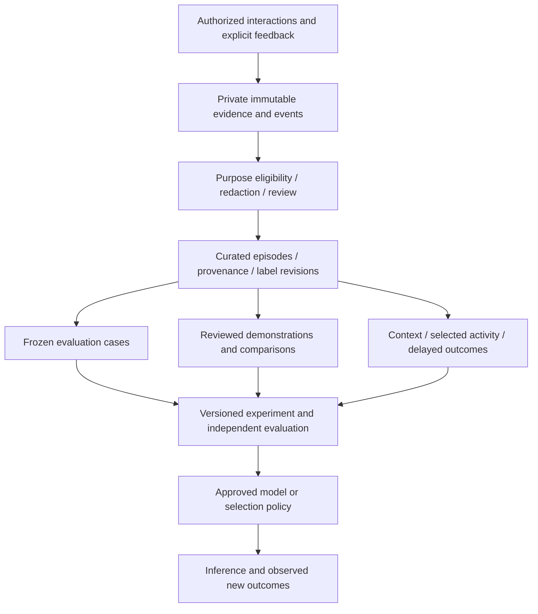

# Learning evidence before training infrastructure

Status: research proposal, 12 October 2026; no training task, model, deployment
or runtime permission is selected. This public note preserves the learning
pipeline, evaluation and self-hosting proposals developed in the private project.
It excludes private source titles, paths and imported evidence. The substantive
original remains in private Git; public export selects this authored note rather
than silently rewriting private records. Implementation status is described in
[the current component overview](../../README.md).

## Own the learning asset

Hoomy should accumulate reviewable evidence during ordinary authorized use, then
release purpose-specific datasets for measured objectives. Owning GPU compute
is different from deciding what data is eligible, what feedback means and what
counts as user benefit. Attention cost, task completion and trust impact are
separate outcomes; engagement is not a sufficient objective.

The existing ingestion tier contains visible user/final-assistant messages,
not a complete agent trajectory. It omits reasoning, tools, commentary and
internal approval reviews. An evidence collection grant is not permission for
personal training, pooled training or a public dataset. Future observable tool
trajectories need a separately reviewed runtime contract; do not widen the
collector implicitly or treat hidden reasoning as a prerequisite.

## Episode information worth retaining

| Information | Research purpose |
| --- | --- |
| Private account/project scope, episode order and time | Prevent cross-user mixing; join delayed outcomes. |
| Source/version identities and coverage | Reconstruct evidence actually available at decision time. |
| Authorized context and constraints | Prevent later facts leaking into earlier inputs. |
| Eligible candidates, chosen activity and abstention | Study timing and selection, including staying quiet. |
| Model/prompt/tool/policy versions | Separate changed behavior from changed environments. |
| Displayed output, explicit corrections and label revisions | Separate generated claims from reviewed demonstrations. |
| Predicted and observed impact/attention, outcome timing | Measure calibration and delayed utility. |
| Purpose permissions, generated-content provenance and expiry | Determine whether a derivative dataset may admit an event. |
| Failure, missingness, disagreement and reviewer confidence | Keep unknown outcomes distinct from negative usefulness. |

A future randomized selection experiment also needs the actual behavior-policy
probability of the chosen action. Inventing probabilities later cannot repair
selection bias. This does not justify adding random exploration to the product.
Current feedback and lifecycle storage changes future prompt context; it is not
an implemented weight-training or reinforcement-learning loop.

## Qualification and evaluation

Keep collection, runtime-context use, personal adaptation and pooled training
permissions separate. Imported/provider-generated outputs need their own
provenance and reuse eligibility. Source evidence remains attributable and
unchanged within its retention policy; normalization and redaction produce
explicit derivatives outside Git.

A qualification process should check scope/permissions, schema/missingness,
secrets and sensitive content, exact/near duplicates, label rubrics and reviewer
disagreement, coverage across successes/corrections/abstentions/languages, and
splits appropriate to the generalization claim. Automated judges may suggest
labels; distinguish them from human review. Automated redaction is not a proof
of safety.

Split at episode/source-family level; all revisions and synchronized copies stay
on the same side. Add project/user grouping and time holdouts where appropriate.
A later reflection may label an earlier event but must not enter its input.
Changing the holdout changes the comparison and must be recorded.

Absence of correction does not certify an answer. An unselected candidate is
not a rejected answer; a preference pair needs comparable context and an actual
comparison signal. A reviewed correction can become a supervised target with
the erroneous output excluded from target loss. Technical failures are not
negative training rewards by default.

Dataset releases should record hashes, source/transformation versions, rubric,
split policy, inclusion/exclusion counts and limits. Link permission withdrawal
to datasets and checkpoint lineage. Deleting a row does not erase its influence
from a trained model; replacement/retirement is a separate policy.

## Improvement targets and baselines

1. Changing personal/project facts: editable memory and retrieval first.
   Correction and removal are harder when facts enter weights.
2. Reusable output behaviors: supervised learning on reviewed examples, or
   preference optimization on qualified comparisons.
3. Activity selection and timing: compare rules, a prompted model, a supervised
   ranker and, where assumptions fit, a contextual bandit before training a whole
   language model.

RL needs a repeatable environment, explicit objective, trustworthy scoring and
value in generating fresh trajectories. Selected historical logs cannot show
what would have happened after an unchosen action. Offline replay cannot prove
causal improvements in long-term wellbeing. Use sandboxes and observable
outcomes; trust boundaries remain deterministic constraints outside the learner.

## Modular infrastructure hypotheses

These links preserve research candidates, not current compatibility or operating
recommendations. Pin and re-evaluate each tool against a real workload before
adoption; no infrastructure is deployed by this note.

| Responsibility | Candidates | Admission question |
| --- | --- | --- |
| Trace inspection and feedback | [Langfuse](https://langfuse.com/self-hosting), [MLflow](https://github.com/mlflow/mlflow) | Can eligible records be inspected without transferring authority over consent/state? Compare overlap before operating both. |
| Human annotation | [Label Studio](https://github.com/HumanSignal/label-studio), [Argilla](https://github.com/argilla-io/argilla) | Does the workflow capture rubric, disagreement and explicit corrections? Verify maintenance/governance boundaries. |
| Detection and curation | [Presidio](https://github.com/data-privacy-stack/presidio), [DataTrove](https://github.com/huggingface/datatrove) | Can language-sensitive redaction/dedup preserve episode structure and measured error rates? |
| Private dataset lineage | [DVC](https://github.com/treeverse/dvc) | Can artifacts and revealing metadata stay private while release transformations remain reproducible? |
| Independent evaluation | Hoomy fictional replay fixtures, [Inspect AI](https://github.com/UKGovernmentBEIS/inspect_ai) | Can the strongest relevant baseline and holdout remain fixed? |
| Narrow batch post-training | [TRL](https://github.com/huggingface/trl), [Axolotl](https://github.com/axolotl-ai-cloud/axolotl) | Can reviewed data improve one task with independently exportable adapters? |
| Training/sampling service | [OpenRL](https://github.com/gke-labs/open-rl), [SkyRL](https://github.com/NovaSky-AI/SkyRL) | Are the intended loss, checkpoint recovery/export and independent serving path actually supported? |
| Distributed RL | [verl](https://github.com/verl-project/verl), [slime](https://github.com/THUDM/slime), [prime-rl](https://github.com/PrimeIntellect-ai/prime-rl), [verifiers](https://github.com/PrimeIntellect-ai/verifiers) | Does measured algorithm/rollout/hardware demand justify distributed operations? |
| Independent inference | [vLLM](https://github.com/vllm-project/vllm), [SGLang](https://github.com/sgl-project/sglang) | Do tokenizer/template/tools/quantization/adapters match the exported model? |
| Smaller activity policy | [Vowpal Wabbit](https://github.com/VowpalWabbit/vowpal_wabbit) | Is mainly immediate feedback suitable for a contextual-bandit comparison? |

River/cloud or on-prem training APIs can separate research scripts from GPU
operations; on-prem access does not establish an open-source server license.
Tinker-like API compatibility does not imply parity with another platform's
export, checkpoint, custom-loss or algorithm features. OpenRL/SkyRL adoption
must test those exact paths and restrictions rather than rely on an overview.
Synthetic-data systems such as Distilabel require maintenance checks and explicit
synthetic provenance; simulated judgments are not real human outcomes. A
source-available alternative such as Phoenix must be evaluated under its actual
license rather than presented as an unrestricted open-source substitute.

## Proposed sequence

| Deliverable | Gate |
| --- | --- |
| Episode contract, purpose matrix, feedback rubric | Reconstruct an eligible episode with known permissions/coverage. |
| Diverse private curation set and qualification report | Usable feedback; missingness and disagreement understood. |
| Frozen holdout and one recurring task | Fair comparison with rules/prompts/memory/retrieval. |
| One narrow post-training/policy experiment | Beats the strongest relevant baseline without unacceptable regressions. |
| Registry, independent serving, rollback | Exercise recovery/export/deletion lineage and serving compatibility. |
| RL task/environment/reward study | Fresh rollouts and a design that can measure improvement. |

Begin evidence design without buying a cluster. Later steps need a specific
objective; dataset size follows coverage and learning curves, not a universal
example-count threshold. Estimate hardware from model/context/optimizer/adapters,
rollout concurrency and measured throughput. Kubernetes/distributed RL remain
optional research follow-ups, not prerequisites for this source candidate.
